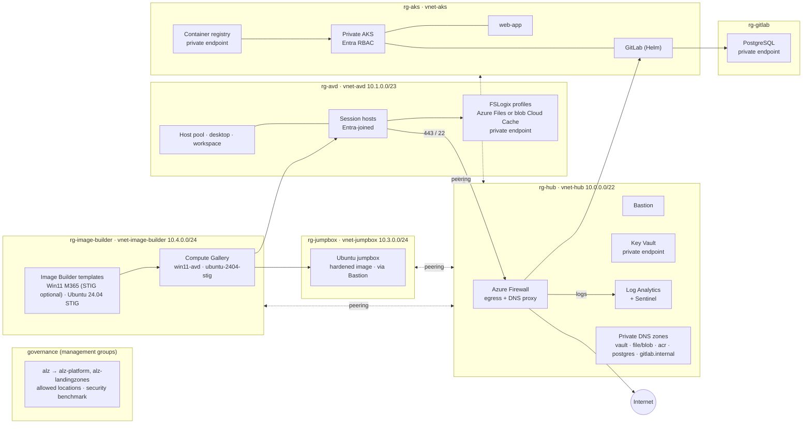

# azure-infrastructure

An Azure platform in plain Bicep: a hub network with a firewall, Azure Virtual Desktop, AKS, a sample app and GitLab. Everything runs in one subscription and one region, and each stack finds the others by fixed resource names.

## What's inside

| Folder | Scope | What it deploys |
|---|---|---|
| [`governance`](governance) | Management group | Management group hierarchy, subscription placement, allowed locations and the Microsoft cloud security benchmark |
| [`hub`](hub) | Resource group `rg-hub` | Hub VNet, Azure Firewall with DNS proxy, Bastion, Log Analytics with Sentinel, Key Vault on a private endpoint, gateway and endpoint subnets, budget |
| [`image-builder`](image-builder) | Resource group `rg-image-builder` | Image Builder spoke (build and container subnets behind the firewall), Compute Gallery, a Windows 11 AVD image (STIG optional) and a STIG-hardened Ubuntu 24.04 image |
| [`jumpbox`](jumpbox) | Resource group `rg-jumpbox` | Jumpbox spoke and an Ubuntu VM from the hardened image (or Marketplace), reached through Bastion |
| [`avd`](avd) | Resource group `rg-avd` | AVD spoke, pooled host pool, desktop, workspace, FSLogix profiles on Azure Files or blob Cloud Cache, Entra-joined session hosts |
| [`aks`](aks) | Resource group `rg-aks` | AKS spoke, private cluster (Entra ID RBAC, CNI Overlay with Cilium, workload identity), container registry on a private endpoint |
| [`apps`](apps) | Kubernetes | Sample web app: Dockerfile, page and manifest on an internal load balancer |
| [`gitlab`](gitlab) | Resource group `rg-gitlab` + Kubernetes | PostgreSQL on a private endpoint, `gitlab.internal` DNS, firewall rules, and the Helm values for GitLab on AKS |
| [`modules`](modules) | | Shared modules: spoke network with IP groups and firewall rules, hub peering, private DNS zone, budget, policy |
| [`docs`](docs) | | [Deployment guide](docs/DEPLOYMENT.md) |

## What gets deployed

Every spoke sends all traffic to the hub firewall (`0.0.0.0/0` route) and uses it as its DNS server, so the private DNS zones linked to the hub resolve everywhere. Each stack adds its own allow rules to the firewall policy as a rule collection group. Every spoke subnet has an IP group in `rg-hub` (`ipg-<spoke>-<subnet>`), and rules use those IP groups as their sources.

## Naming

Resources are named `<type>-<workload>[-<detail>]` with the [Cloud Adoption Framework abbreviations](https://learn.microsoft.com/azure/cloud-adoption-framework/ready/azure-best-practices/resource-abbreviations): `rg-avd`, `vnet-avd`, `afw-hub`, `aks-platform`, `pe-gitlab-postgres`, `ipg-aks-snet-nodes`, `rcg-aks`. Names that must be globally unique add a 6-character suffix derived from the subscription (`kv-hub-<sfx>`, `psql-gitlab-<sfx>`), without hyphens where Azure doesn't allow them (`craks<sfx>`, `stavd<sfx>`). The gallery is `gal_images` because gallery names can't contain hyphens.

## Prerequisites

- Azure CLI (`az bicep` installs on first use)
- Owner on the subscription
- Owner at the tenant root management group, for `governance`
- Permission to create Entra ID security groups

## Deploy

Follow [docs/DEPLOYMENT.md](docs/DEPLOYMENT.md).

**Don't commit real IDs.** The `.bicepparam` files hold placeholders such as `<alert-email>`. Fill them in locally and keep those changes out of Git.
