# azure-infrastructure

An Azure platform in plain Bicep: a hub network with a firewall, Azure Virtual Desktop, AKS, a sample app and GitLab. Everything runs in one subscription and one region, and each stack finds the others by fixed resource names.

## What's inside

| Folder | Scope | What it deploys |
|---|---|---|
| [`governance`](governance) | Management group | Management group hierarchy, subscription placement, allowed locations and the Microsoft cloud security benchmark |
| [`hub`](hub) | Resource group `s-rg-mipapi-hub` | Hub VNet, Azure Firewall with DNS proxy, Bastion, Log Analytics with Sentinel, Key Vault on a private endpoint, gateway and endpoint subnets, budget |
| [`image-builder`](image-builder) | Resource group `s-rg-mipapi-images` | Image Builder spoke (build, container and endpoint subnets behind the firewall), storage account for scripts and installers on a private endpoint with `publish.sh`, Compute Gallery. One param file per image in `images/` (source, apps, STIG): Windows 11 AVD, STIG-hardened Ubuntu 24.04, and a Windows 11 + VLC example |
| [`jumpbox`](jumpbox) | Resource group `s-rg-mipapi-jumpbox` | Jumpbox spoke and an Ubuntu VM from the hardened image (or Marketplace), reached through Bastion |
| [`avd`](avd) | Resource group `s-rg-mipapi-avd` | AVD spoke, pooled host pool, desktop, workspace, FSLogix profiles on Azure Files or blob Cloud Cache, Entra-joined session hosts |
| [`aks`](aks) | Resource groups `s-rg-mipapi-apps`, `s-rg-mipapi-gitlab` | Two clusters from one template, one param file each (`clusters/`): apps (with the container registry on a private endpoint) and GitLab, each in its own spoke. Private clusters with Entra ID RBAC, CNI Overlay with Cilium, workload identity |
| [`apps`](apps) | Kubernetes | Sample web app: Dockerfile, page and manifest on an internal load balancer |
| [`gitlab`](gitlab) | Resource group `s-rg-mipapi-gitlab` + Kubernetes | PostgreSQL, Azure Managed Redis and blob storage (workload identity, no keys) on private endpoints, `gitlab.internal` DNS, firewall rules, and the Helm values for GitLab on AKS |
| [`modules`](modules) | | Shared modules: spoke network with IP groups and firewall rules, hub peering, private DNS zone, budget, policy |
| [`docs`](docs) | | [Deployment guide](docs/DEPLOYMENT.md) |

## What gets deployed

<picture>
  <source media="(prefers-color-scheme: dark)" srcset="docs/diagrams/platform.dark.svg">
  
</picture>

🟨 governance &nbsp; 🟥 security and edge &nbsp; 🟦 network and compute &nbsp; 🟩 data and storage &nbsp; 🟪 monitoring &nbsp; 🟧 images and CI. Source: <a href="docs/diagrams/platform.mmd">docs/diagrams/platform.mmd</a>.

Every spoke sends all traffic to the hub firewall (`0.0.0.0/0` route) and uses it as its DNS server, so the private DNS zones linked to the hub resolve everywhere. Each stack adds its own allow rules to the firewall policy as a rule collection group. Every spoke subnet has an IP group in the hub resource group (`<env>-ipg-<workload>-<spoke>-<subnet>`), and rules use those IP groups as their sources.

## Naming

Every name is `<env>-<type>-<workload>-<component>`: `env` is `p` (prod) or `s` (staging), `type` is the abbreviation from the [Azure periodic table](https://www.azureperiodictable.com), and `workload` is `mipapi`. Examples: `s-rg-mipapi-hub`, `s-afw-mipapi-hub`, `s-vdpool-mipapi-avd`, `s-aks-mipapi-apps`, `s-pep-mipapi-gitlab-postgres`, `s-ipg-mipapi-avd-hosts`. Globally unique names add a 6-character suffix derived from the subscription (`s-kv-mipapi-hub-<sfx>`, `s-psql-mipapi-gitlab-<sfx>`), and names that can't have hyphens join the parts (`sstmipapiavd<sfx>`, `scrmipapiapps<sfx>`, gallery `sgalmipapi`). Session hosts are `<prefix><hash>-<nnn>` so a deleted host's Entra device never blocks a new one. All names come from one place, [`modules/naming.bicep`](modules/naming.bicep), and every param file sets `env` and `workload`.

## Prerequisites

- Azure CLI (`az bicep` installs on first use)
- Owner on the subscription
- Owner at the tenant root management group, for `governance`
- Permission to create Entra ID security groups

## Deploy

Follow [docs/DEPLOYMENT.md](docs/DEPLOYMENT.md).

**Don't commit real IDs.** The `.bicepparam` files hold placeholders such as `<alert-email>`. Fill them in locally and keep those changes out of Git.
