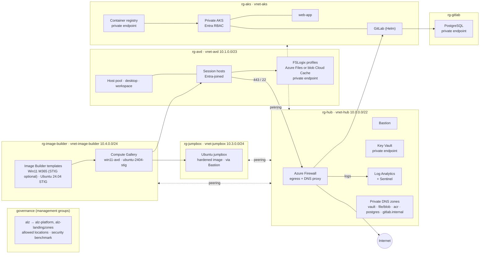

# azure-infrastructure

An Azure platform in plain Bicep: a hub network with a firewall, Azure Virtual Desktop, AKS, a sample app and GitLab. Everything runs in one subscription and one region, and each stack finds the others by fixed resource names.

| Folder | Deploys |
|---|---|
| `governance` | Management groups, subscription placement, two baseline policies |
| `hub` | Hub network, Azure Firewall (egress and DNS for every spoke), Bastion, Log Analytics with Sentinel, Key Vault, budget |
| `image-builder` | Image Builder spoke, Compute Gallery, templates for the AVD image (STIG optional) and a STIG-hardened Ubuntu image |
| `jumpbox` | Jumpbox spoke and an Ubuntu VM from the hardened image (or Marketplace), reached through Bastion |
| `avd` | AVD spoke, host pool, desktop, workspace, FSLogix profile storage, Entra-joined session hosts |
| `aks` | AKS spoke, private cluster with Entra ID RBAC, private container registry |
| `apps` | Sample web app (Dockerfile and Kubernetes manifest) |
| `gitlab` | PostgreSQL for GitLab, DNS, firewall rules and Helm values |
| `modules` | Small modules shared by the stacks |

## What gets deployed

Every spoke sends all traffic to the hub firewall (`0.0.0.0/0` route) and uses it as its DNS server, so the private DNS zones linked to the hub resolve everywhere. Each stack adds its own allow rules to the firewall policy as a rule collection group. Every spoke subnet has an IP group in `rg-hub` (`ipg-<spoke>-<subnet>`), and rules use those IP groups as their sources.

## Prerequisites

- Azure CLI (`az bicep` installs on first use)
- Owner on the subscription
- Owner at the tenant root management group, for `governance`
- Permission to create Entra ID security groups

## Deploy

Follow [docs/DEPLOYMENT.md](docs/DEPLOYMENT.md).

**Don't commit real IDs.** The `.bicepparam` files hold placeholders such as `<alert-email>`. Fill them in locally and keep those changes out of Git.
