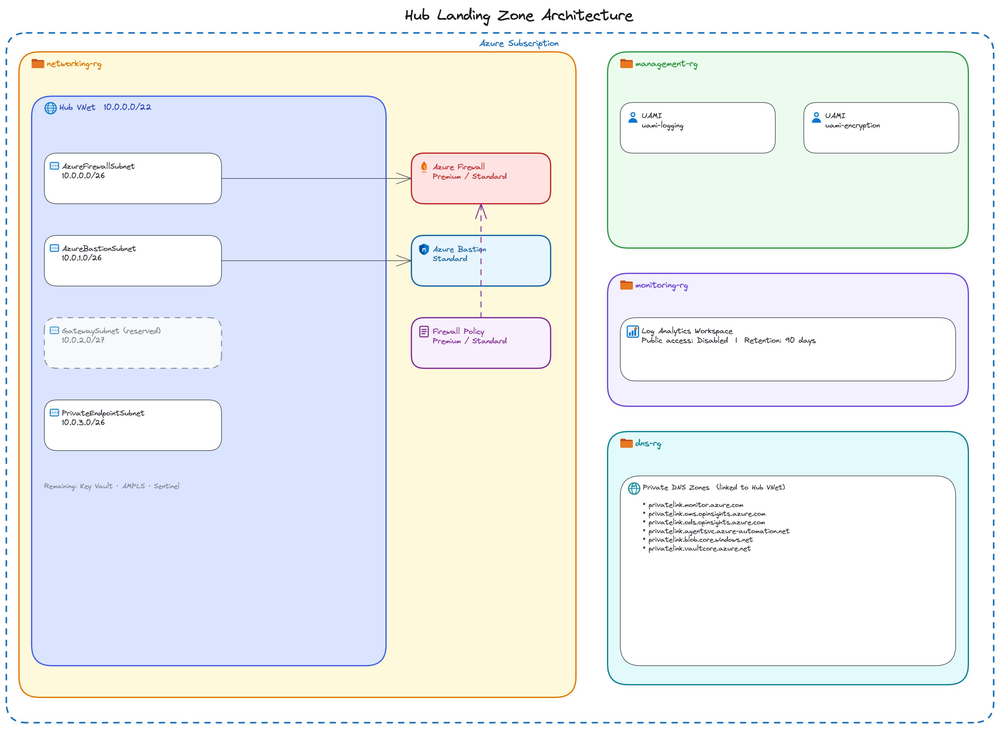
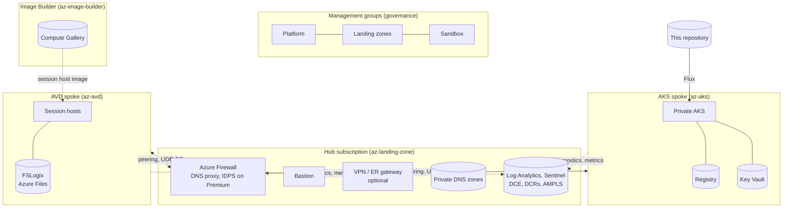
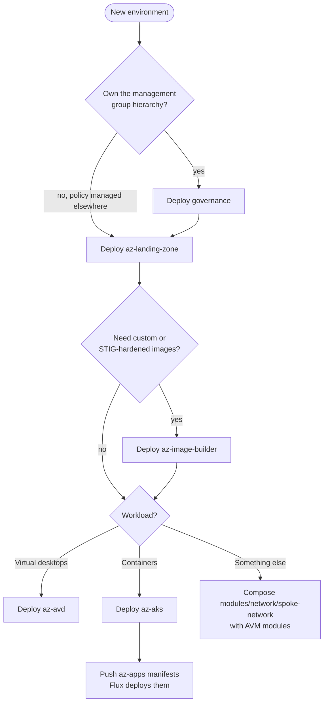

# azure-infrastructure

Bicep for an Azure platform built on [Azure Verified Modules (AVM)](https://azure.github.io/Azure-Verified-Modules/): governance, a hub-and-spoke landing zone, Azure Virtual Desktop, AKS, the applications that run on AKS, and STIG-hardened images. Every folder deploys to a `staging` and a `prod` environment from its own parameter files.

## What's inside

| Folder | Scope | What it deploys |
|---|---|---|
| [`az-landing-zone/governance`](az-landing-zone/governance) | Management group | Management group hierarchy, subscription placement, baseline policy (staging deploys a canary hierarchy) |
| [`az-landing-zone`](az-landing-zone) | Subscription | Hub VNet, Azure Firewall with DNS proxy, Bastion, optional VPN/ExpressRoute gateway and DDoS, private DNS zones, Log Analytics with optional Sentinel, data collection rules and endpoint, AMPLS, Key Vault, budgets, Defender for Cloud |
| [`az-image-builder`](az-image-builder) | Subscription | Isolated Image Builder environment and STIG-hardened Windows and Linux images in a Compute Gallery |
| [`az-avd`](az-avd) | Subscription | AVD spoke, host pool, application groups, workspace, scaling plan, FSLogix on Azure Files with Entra Kerberos, session hosts, AVD Insights and alerts |
| [`az-aks`](az-aks) | Subscription | AKS spoke, private cluster (Entra RBAC, CNI Overlay with Cilium, workload identity), registry, key vault, Managed Prometheus and Grafana, Flux GitOps |
| [`az-apps`](az-apps) | Kubernetes | Hardened Helm chart, namespace guardrails, Flux releases, CI that builds, scans, signs and promotes images by digest |
| [`modules`](modules) | | Shared modules: naming, types, spoke network, firewall rule collection group, AVD and AKS building blocks |
| [`docs`](docs) | | [Architecture](docs/ARCHITECTURE.md), [conventions](docs/CONVENTIONS.md), [decision log](docs/DECISIONS.md) |



## Architecture



All egress from spokes goes through the hub firewall, which also resolves the hub's private DNS zones for the spokes. PaaS services are reached through private endpoints; monitoring ingestion goes through the private link scope.

## Which folders do I need?



## Deployment order

| # | Deployment | Command | Needs |
|---|---|---|---|
| 1 | Governance | `az deployment mg create -m <root-mg> -l eastus -f az-landing-zone/governance/main.bicep -p az-landing-zone/governance/params/<env>.bicepparam` | Management group write at the root |
| 2 | Hub | `az deployment sub create -l eastus -f az-landing-zone/main.bicep -p az-landing-zone/params/<env>.bicepparam` | 1 (optional) |
| 3 | Image Builder | `az-image-builder/tools/Deploy-ImageBuilder.ps1` (see its README) | 2 |
| 4 | AVD | `az deployment sub create -l eastus -f az-avd/main.bicep -p az-avd/params/<env>.bicepparam` | 2, outputs `hub`, `monitoring`, `firewallPolicyResourceId`; 3 for custom images |
| 5 | AKS | `az deployment sub create -l eastus -f az-aks/main.bicep -p az-aks/params/<env>.bicepparam` | 2, same outputs |
| 6 | Apps | Merge to the branch Flux follows | 5 |

Workload parameter files take the hub outputs as resource IDs, so the hub and the workloads can live in different subscriptions. Values in `<angle brackets>` and all-zero GUIDs in parameter files are placeholders.

## Validation

Everything runs in a pinned tooling container (`tooling/Dockerfile`: Bicep, PSRule for Azure, Helm, kustomize, kubeconform, kind, kubectl), so only Docker is needed:

```bash
make tools      # build the tooling image
make validate   # bicep build, lint, format check, PSRule, Checkov, Kubernetes manifests, README tables
make scan       # Checkov only (Kubernetes, Helm, Actions, Dockerfile, secrets)
make smoke      # kind cluster smoke test of az-apps
make docs       # regenerate README parameter tables
```

CI (`.github/workflows/validate.yml`) runs the same targets on every pull request. `.github/workflows/what-if.yml` runs `what-if` for each deployment against a sandbox subscription through OIDC once the repository variable `WHAT_IF_ENABLED` is `true`. Install the pre-commit hooks with `pre-commit install`.

## Conventions

- AVM modules pinned to exact versions; local modules only where AVM has no module or misses something, each explained in [DECISIONS.md](docs/DECISIONS.md).
- Typed parameters (`types.bicep`), names from `modules/shared/naming.bicep` (`<workload>-<environment>-<region>-<abbreviation>`), required tags `environment` and `workload`.
- Private endpoints, diagnostic settings to the central workspace, `CanNotDelete` locks in prod, Entra-only authentication where the service supports it.
- Dependencies (AVM modules, actions, images, charts, tools) are updated by Renovate.

See [CONVENTIONS.md](docs/CONVENTIONS.md) for details.
