# azure-infrastructure

Bicep for an Azure platform built on [Azure Verified Modules (AVM)](https://azure.github.io/Azure-Verified-Modules/): governance, a hub-and-spoke landing zone, Azure Virtual Desktop, AKS, the applications that run on AKS, and STIG-hardened images. Every folder deploys to a `staging` and a `prod` environment from its own parameter files.

## What's inside

| Folder | Scope | What it deploys |
|---|---|---|
| [`az-landing-zone/governance`](az-landing-zone/governance) | Management group | Management group hierarchy, subscription placement, baseline policy (staging deploys a canary hierarchy) |
| [`az-landing-zone`](az-landing-zone) | Subscription | Hub VNet, Azure Firewall with DNS proxy, Bastion, optional VPN/ExpressRoute gateway and DDoS, private DNS zones, Log Analytics with optional Sentinel, data collection rules and endpoint, AMPLS, Key Vault, budgets, Defender for Cloud |
| [`az-image-builder`](az-image-builder) | Subscription | Isolated Image Builder environment and STIG-hardened Windows and Linux images in a Compute Gallery |
| [`az-avd`](az-avd) | Subscription | AVD spoke, host pool, application groups, workspace, scaling plan, FSLogix on Azure Files with Entra Kerberos, session hosts, AVD Insights and alerts |
| [`az-aks`](az-aks) | Subscription | AKS spoke, private cluster (Entra RBAC, CNI Overlay with Cilium, workload identity), registry, key vault, Managed Prometheus and Grafana, Flux GitOps, optional AKS Backup. Also builds the tools cluster for GitLab (`params/tools-prod.bicepparam`) |
| [`az-gitlab`](az-gitlab) | Subscription + Kubernetes | Internal GitLab on the tools cluster: PostgreSQL, Managed Redis and Blob Storage on private endpoints, in-cluster Gitaly, DNS records, firewall rules, and the Flux manifests for GitLab and its runners |
| [`az-apps`](az-apps) | Kubernetes | Hardened Helm chart, namespace guardrails, Flux releases, CI that builds, scans, signs and promotes images by digest |
| [`modules`](modules) | | Shared modules: naming, types, spoke network, firewall rule collection group, AVD, AKS, GitLab and governance building blocks |
| [`docs`](docs) | | [Deployment guide](docs/DEPLOYMENT.md), [architecture](docs/ARCHITECTURE.md), [conventions](docs/CONVENTIONS.md), [decision log](docs/DECISIONS.md) |

## Architecture

<p align="center">
<picture>
  <source media="(prefers-color-scheme: dark)" srcset="docs/diagrams/platform-overview.dark.svg">
  
</picture>
</p>

<sub>🟨 governance &nbsp; 🟥 security and edge &nbsp; 🟦 network and compute &nbsp; 🟩 data and storage &nbsp; 🟪 monitoring &nbsp; 🟧 CI/CD and images. Sources and build: <a href="docs/diagrams">docs/diagrams</a>.</sub>

All egress from spokes goes through the hub firewall, which also resolves the hub's private DNS zones for the spokes. PaaS services are reached through private endpoints; monitoring ingestion goes through the private link scope. GitLab is internal only: AVD session hosts and VPN or ExpressRoute clients reach it through the firewall on 443 and 22. The tools cluster follows hosted Git, so GitLab can be rebuilt without GitLab; the application cluster moves to GitLab once it runs ([az-gitlab](az-gitlab/README.md#bootstrap-order)).

### Why two AKS clusters?

Prod runs two clusters from the same `az-aks` template: the **app AKS cluster** for workloads and the **tools AKS cluster** for GitLab, Gitaly and CI runners, each in its own spoke. CI runners execute whatever code is pushed to any project, which is close to what Microsoft calls hostile multi-tenancy, where it recommends ["physically isolated clusters"](https://learn.microsoft.com/azure/aks/operator-best-practices-cluster-isolation). The Well-Architected guide for AKS also calls separate clusters for unrelated workloads ["the strongest isolation boundary"](https://learn.microsoft.com/azure/well-architected/service-guides/azure-kubernetes-service). The separation also means a GitLab upgrade or a runaway job can't take applications down.

A second cluster has a cost: another control plane, system pool and monitoring stack to run and upgrade. That's why Microsoft's default is to minimize cluster count. Staging takes the other path: `az-gitlab` `placement: 'Shared'` runs GitLab and the runners on tainted node pools in the application cluster, with the runners in their own subnet. The trade-offs are in [D-033](docs/DECISIONS.md#d-033-gitlab-on-aks).

## Which folders do I need?

<p align="center">
<picture>
  <source media="(prefers-color-scheme: dark)" srcset="docs/diagrams/deploy-decision.dark.svg">
  
</picture>
</p>

## Deployment order

New to this repository? **[docs/DEPLOYMENT.md](docs/DEPLOYMENT.md)** walks through the whole process from an empty tenant: tools, permissions, Entra groups, placeholders, deploying each stack, wiring outputs between them, checks and teardown. It also has a short staging sandbox path (hub plus one AKS cluster). The table below is the summary.

| # | Deployment | Command | Needs |
|---|---|---|---|
| 1 | Governance | `az deployment mg create -m <root-mg> -l eastus -f az-landing-zone/governance/main.bicep -p az-landing-zone/governance/params/<env>.bicepparam` | Management group write at the root |
| 2 | Hub | `az deployment sub create -l eastus -f az-landing-zone/main.bicep -p az-landing-zone/params/<env>.bicepparam` | 1 (optional) |
| 3 | Image Builder | `az-image-builder/tools/Deploy-ImageBuilder.ps1` (see its README) | 2 |
| 4 | AVD | `az deployment sub create -l eastus -f az-avd/main.bicep -p az-avd/params/<env>.bicepparam` | 2, outputs `hub`, `monitoring`, `firewallPolicyResourceId`; 3 for custom images |
| 5 | AKS | `az deployment sub create -l eastus -f az-aks/main.bicep -p az-aks/params/<env>.bicepparam` | 2, same outputs |
| 6 | Apps | Merge to the branch Flux follows | 5 |
| 7 | Tools cluster | `az deployment sub create -l eastus -f az-aks/main.bicep -p az-aks/params/tools-prod.bicepparam` | 2, same outputs; follows hosted Git |
| 8 | GitLab | `az deployment sub create -l eastus -f az-gitlab/main.bicep -p az-gitlab/params/<env>.bicepparam`, then the bootstrap steps in [az-gitlab](az-gitlab/README.md#bootstrap-order) | 7 (prod) or 5 (staging, shared cluster); GitLab DNS zones in 2 |

Workload parameter files take the hub outputs as resource IDs, so the hub and the workloads can live in different subscriptions. Values in `<angle brackets>` and all-zero GUIDs in parameter files are placeholders.

## Validation

Everything runs in a pinned tooling container (`tooling/Dockerfile`: Bicep, PSRule for Azure, Helm, kustomize, kubeconform, kind, kubectl), so only Docker is needed:

```bash
make tools      # build the tooling image
make validate   # bicep build, lint, format check, PSRule, snapshots, cross-deployment checks,
                # Checkov, Kubernetes manifests, rendered GitLab manifests, README tables
make scan       # Checkov only (Kubernetes, Helm, Actions, Dockerfile, secrets)
make snapshot   # offline evaluation of every params and test file (bicep snapshot) with expectations
make deployments # address plan, CI runner pools, GitLab private endpoints
make rendered   # GitLab overlays rendered with their charts: no public ingress, LB only in gitlab
make smoke      # kind cluster smoke test of az-apps
make docs       # regenerate README parameter tables
```

CI (`.github/workflows/validate.yml`) runs the same targets on every pull request. `.github/workflows/what-if.yml` runs `what-if` for each deployment against a sandbox subscription through OIDC once the repository variable `WHAT_IF_ENABLED` is `true`. Install the pre-commit hooks with `pre-commit install`.

## Conventions

- AVM modules pinned to exact versions; local modules only where AVM has no module or misses something, each explained in [DECISIONS.md](docs/DECISIONS.md).
- Typed parameters (`types.bicep`), names from `modules/shared/naming.bicep` (`<workload>-<environment>-<region>-<abbreviation>`), required tags `environment` and `workload`.
- Private endpoints, diagnostic settings to the central workspace, `CanNotDelete` locks in prod, Entra-only authentication where the service supports it.
- Dependencies (AVM modules, actions, images, charts, tools) are updated by Renovate.

See [CONVENTIONS.md](docs/CONVENTIONS.md) for details.
