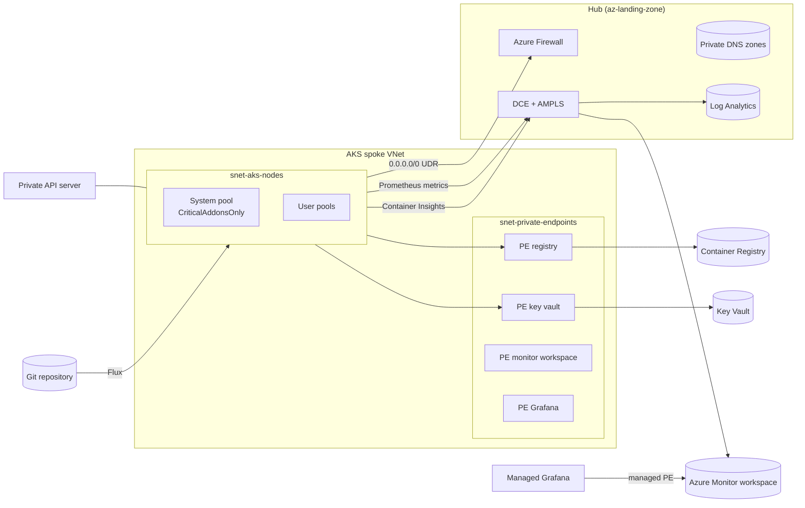

# Azure Kubernetes Service

A private AKS cluster on a spoke of the landing zone, with its registry, workload key vault, Managed Prometheus, Managed Grafana, Container Insights and Flux GitOps. One deployment of `main.bicep` is one cluster.



## What it deploys

| Area | Choice |
|---|---|
| API server | Private cluster, no public FQDN, A record in the hub's `privatelink.<region>.azmk8s.io` zone |
| Identity | Entra ID with Azure RBAC for Kubernetes, local accounts disabled, user-assigned control plane and kubelet identities |
| Network | Azure CNI Overlay powered by Cilium (data plane and network policy), outbound through the hub firewall (`userDefinedRouting`) |
| Nodes | Azure Linux, ephemeral OS disks, encryption at host, autoscaling, system pool tainted `CriticalAddonsOnly` |
| Upgrades | `patch` channel and `NodeImage` node OS channel inside a weekly maintenance window |
| Workloads | Workload identity and OIDC issuer, Key Vault CSI driver with rotation, KEDA, application routing (internal NGINX), Azure Policy, image cleaner, Defender for Containers |
| Registry | Premium, private endpoint only, admin user and anonymous pull off, AcrPull for the kubelet identity |
| Secrets | Key Vault (RBAC, purge protection, private endpoint) read by External Secrets Operator through a federated identity |
| Monitoring | Managed Prometheus with recording and alert rules, Container Insights with Entra authentication and ContainerLogV2, control plane logs, Managed Grafana |
| GitOps | Flux extension following `az-aks/gitops/clusters/<environment>` |

## Prerequisites

- `az-landing-zone` deployed; its outputs fill `hub`, `monitoring` and `firewallPolicyResourceId`. The data collection endpoint must be in the cluster's region.
- The hub DNS resource group holds `privatelink.<region>.azmk8s.io`, `privatelink.azurecr.io`, `privatelink.vaultcore.azure.net`, `privatelink.<region>.prometheus.monitor.azure.com` and `privatelink.grafana.azure.com` (landing zone defaults).
- The deploying identity needs Owner, or Contributor plus Role Based Access Control Administrator, on the subscription and on the hub DNS resource group.
- Resource providers `Microsoft.ContainerService`, `Microsoft.KubernetesConfiguration`, `Microsoft.Monitor`, `Microsoft.Dashboard`, `Microsoft.AlertsManagement`.
- Entra groups for cluster admins and readers.

## Deploy

```bash
az deployment sub create --location eastus --name aks-prod \
  --template-file az-aks/main.bicep --parameters az-aks/params/prod.bicepparam
```

### After the first deployment

1. Approve the Grafana managed private endpoint on the Azure Monitor workspace (**Networking > Private endpoint connections**). Until then Grafana can't query Prometheus.
2. Put the deployment outputs into `az-aks/gitops/clusters/<environment>/cluster-settings.yaml` (`keyVaultUri`, `externalSecretsClientId`, `registryLoginServer`, tenant ID) and push. Flux applies them on the next sync.
3. Get credentials from a machine with line of sight to the private API server (Bastion jump host, VPN or a self-hosted runner in a peered network):
   ```bash
   az aks get-credentials -g <cluster-rg> -n <cluster> && kubelogin convert-kubeconfig -l azurecli
   ```
   `az aks command invoke` also works without network access to the API server.

## Network

| CIDR | Default | Notes |
|---|---|---|
| Nodes | `/24` or larger | Only nodes take VNet addresses with Overlay |
| Pods | `192.168.0.0/16` | Not routable outside the cluster; must not overlap networks the pods talk to |
| Services | `172.16.0.0/16`, DNS `172.16.0.10` | Same rule |

This deployment adds a rule collection group to the hub firewall policy: the `AzureKubernetesService` FQDN tag (control plane, MCR, node packages), Azure Monitor, Azure Policy, the Flux data plane and Entra sign-in. `allowedEgressFqdns` adds Git hosting and public chart and image registries; mirror images into the registry (for example with ACR cache rules) to shrink that list. The full requirement list is in [Outbound network and FQDN rules for AKS](https://learn.microsoft.com/azure/aks/outbound-rules-control-egress).

Workload pods can't reach the instance metadata service or the Azure host endpoint (`gitops/infrastructure/configs/deny-node-endpoints.yaml`); they use workload identity instead.

## GitOps

```
az-aks/gitops/
  clusters/<env>/            entry point applied by the Flux extension
    cluster-settings.yaml    deployment outputs used for substitution
    infrastructure.yaml      infra-controllers -> infra-configs
    apps.yaml                platform (az-apps/platform) -> apps (az-apps/deploy)
  infrastructure/
    controllers/             External Secrets Operator, cert-manager (Helm)
    configs/                 ClusterSecretStore, internal CA issuer, IMDS deny
```

Each layer waits for the previous one (`dependsOn`). Chart versions are pinned; Renovate proposes updates.

## Access

| Group | Azure role | Kubernetes effect |
|---|---|---|
| `access.adminGroupObjectIds` | Azure Kubernetes Service RBAC Cluster Admin, Cluster User, Grafana Admin | cluster-admin |
| `access.readerGroupObjectIds` | Azure Kubernetes Service RBAC Reader, Cluster User | read most objects in every namespace, no secrets |
| `access.grafanaViewerGroupObjectIds` | Grafana Viewer | dashboards only |

Grant namespace-scoped access with Azure Kubernetes Service RBAC Writer at `<cluster id>/namespaces/<name>`.

## Staging vs prod

| | staging | prod |
|---|---|---|
| Tier | Free | Standard (uptime SLA) |
| Zones | none | 1, 2, 3 for node pools, registry and Grafana |
| System pool | 2-3 nodes | 3-5 nodes |
| User pool | 1-3 x D4ds_v5 | 3-10 x D8ds_v5 |
| Locks | none | CanNotDelete |

## Parameters

<!-- BEGIN_PARAMS -->
| Parameter | Type | Required | Default | Description |
|---|---|---|---|---|
| `environment` | environmentType | yes |  | Environment. |
| `location` | string | yes |  | Region for every resource. |
| `workload` | string | no | `"aks"` | Workload name used in resource names. |
| `tags` | tagsType | yes |  | Tags applied to every resource. |
| `hub` | hubReferenceType | yes |  | Hub connection details (az-landing-zone output "hub"). |
| `monitoring` | monitoringReferenceType | yes |  | Central monitoring (az-landing-zone output "monitoring"). The data collection endpoint is required for private ingestion. |
| `firewallPolicyResourceId` | string | no | `""` | Hub firewall policy (az-landing-zone output firewallPolicyResourceId). When set, the AKS egress rules are added to it. |
| `firewallRulePriority` | int | no | `1100` | Priority of the AKS rule collection group in the hub firewall policy. |
| `allowedEgressFqdns` | string[] | no | `[]` | Extra FQDNs the nodes may reach over HTTPS, for example Git hosting or public chart and image registries that are not mirrored into the registry. |
| `network` | aksNetworkType | yes |  | Spoke network. |
| `cluster` | clusterType | yes |  | Cluster and node pools. |
| `access` | accessType | yes |  | Access. |
| `gitOps` | gitOpsType | no |  | GitOps with the Flux extension. Leave empty to manage workloads another way. |
| `aksMonitoring` | aksMonitoringType | no | `{}` | Monitoring options. |
| `enableTelemetry` | bool | no | `true` | Enable AVM usage telemetry. |

| Output | Type | Description |
|---|---|---|
| `clusterResourceId` | string | Resource ID of the cluster. |
| `clusterName` | string | Name of the cluster. |
| `clusterResourceGroupName` | string | Resource group of the cluster. |
| `oidcIssuerUrl` | string | OIDC issuer URL for workload identity federation. |
| `registryLoginServer` | string | Login server of the container registry. |
| `registryName` | string | Name of the container registry. |
| `keyVaultUri` | string | URI of the workload key vault. |
| `externalSecretsClientId` | string | Client ID of the External Secrets identity (service account annotation azure.workload.identity/client-id). |
| `monitorWorkspaceResourceId` | string | Resource ID of the Azure Monitor workspace. |
| `grafanaResourceId` | string | Resource ID of Managed Grafana. |
<!-- END_PARAMS -->
