# Azure Kubernetes Service

A private AKS cluster on a spoke of the landing zone, with its registry, workload key vault, Managed Prometheus, Managed Grafana, Container Insights and Flux GitOps. One deployment of `main.bicep` is one cluster.

<p align="center">
<picture>
  <source media="(prefers-color-scheme: dark)" srcset="../docs/diagrams/aks-spoke.dark.svg">
  
</picture>
</p>

## What it deploys

| Area | Choice |
|---|---|
| API server | Private cluster, no public FQDN, A record in the hub's `privatelink.<region>.azmk8s.io` zone |
| Identity | Entra ID with Azure RBAC for Kubernetes, local accounts disabled, user-assigned control plane and kubelet identities |
| Network | Azure CNI Overlay powered by Cilium (data plane and network policy), outbound through the hub firewall (`userDefinedRouting`) |
| Nodes | Azure Linux, ephemeral OS disks, encryption at host, autoscaling, system pool tainted `CriticalAddonsOnly` |
| Upgrades | `patch` channel and `NodeImage` node OS channel inside a weekly maintenance window |
| Workloads | Workload identity and OIDC issuer, Key Vault CSI driver with rotation, KEDA, application routing (internal NGINX), Azure Policy, image cleaner, Defender for Containers |
| Registry | Premium, private endpoint only, admin user and anonymous pull off, AcrPull for the kubelet identity |
| Secrets | Key Vault (RBAC, purge protection, private endpoint) read by External Secrets Operator through a federated identity |
| Monitoring | Managed Prometheus with recording and alert rules, Container Insights with Entra authentication and ContainerLogV2, control plane logs, Managed Grafana |
| GitOps | Flux extension following `az-aks/gitops/clusters/<environment>` |

## Prerequisites

- `az-landing-zone` deployed; its outputs fill `hub`, `monitoring` and `firewallPolicyResourceId`. The data collection endpoint must be in the cluster's region.
- The hub DNS resource group holds `privatelink.<region>.azmk8s.io`, `privatelink.azurecr.io`, `privatelink.vaultcore.azure.net`, `privatelink.<region>.prometheus.monitor.azure.com` and `privatelink.grafana.azure.com` (landing zone defaults).
- The deploying identity needs Owner, or Contributor plus Role Based Access Control Administrator, on the subscription and on the hub DNS resource group.
- Resource providers `Microsoft.ContainerService`, `Microsoft.KubernetesConfiguration`, `Microsoft.Monitor`, `Microsoft.Dashboard`, `Microsoft.AlertsManagement`.
- Entra groups for cluster admins and readers.

## Deploy

```bash
az deployment sub create --location eastus --name aks-prod \
  --template-file az-aks/main.bicep --parameters az-aks/params/prod.bicepparam
```

### After the first deployment

1. Approve the Grafana managed private endpoint on the Azure Monitor workspace (**Networking > Private endpoint connections**). Until then Grafana can't query Prometheus.
2. Put the deployment outputs into `az-aks/gitops/clusters/<environment>/cluster-settings.yaml` (`keyVaultUri`, `externalSecretsClientId`, `registryLoginServer`, tenant ID) and push. Flux applies them on the next sync.
3. Get credentials from a machine with line of sight to the private API server (Bastion jump host, VPN or a self-hosted runner in a peered network):
   ```bash
   az aks get-credentials -g <cluster-rg> -n <cluster> && kubelogin convert-kubeconfig -l azurecli
   ```
   `az aks command invoke` also works without network access to the API server.

## Network

| CIDR | Default | Notes |
|---|---|---|
| Nodes | `/24` or larger | Only nodes take VNet addresses with Overlay |
| Pods | `192.168.0.0/16` | Not routable outside the cluster; must not overlap networks the pods talk to |
| Services | `172.16.0.0/16`, DNS `172.16.0.10` | Same rule |

This deployment adds a rule collection group to the hub firewall policy: the `AzureKubernetesService` FQDN tag (control plane, MCR, node packages), Azure Monitor, Azure Policy, the Flux data plane and Entra sign-in. `allowedEgressFqdns` adds Git hosting and public chart and image registries; mirror images into the registry (for example with ACR cache rules) to shrink that list. The full requirement list is in [Outbound network and FQDN rules for AKS](https://learn.microsoft.com/azure/aks/outbound-rules-control-egress).

`useFirewallIpGroups: true` creates IP Groups for the node and private endpoint subnets (`<cluster>-ipg-nodes`, `-ipg-private-endpoints`) and sources every rule from the node group. The `ipGroupResourceIds` output lets other workloads write rules against this spoke without copying its prefixes (D-028).

Workload pods can't reach the instance metadata service or the Azure host endpoint (`gitops/infrastructure/configs/deny-node-endpoints.yaml`); they use workload identity instead.

## GitOps

```
az-aks/gitops/
  clusters/<env>/            entry point applied by the Flux extension
    cluster-settings.yaml    deployment outputs used for substitution
    infrastructure.yaml      infra-controllers -> infra-configs
    apps.yaml                platform (az-apps/platform) -> apps (az-apps/deploy)
  clusters/tools-prod/       tools cluster: infrastructure, then GitLab (az-gitlab/gitops)
  infrastructure/
    controllers/             External Secrets Operator, cert-manager (Helm)
    configs/                 ClusterSecretStore, internal CA issuer, IMDS deny
  optional/                  off until added to a cluster: image verification (Kyverno),
                             Trivy Operator, external-dns, Actions Runner Controller
```

A deployment with a `workload` other than `aks` follows `clusters/<workload>-<environment>` by default, so the tools cluster (`workload: 'tools'`) reads `clusters/tools-prod`.

Each layer waits for the previous one (`dependsOn`). Chart versions are pinned; Renovate proposes updates.

## Access

| Group | Azure role | Kubernetes effect |
|---|---|---|
| `access.adminGroupObjectIds` | Azure Kubernetes Service RBAC Cluster Admin, Cluster User, Grafana Admin | cluster-admin |
| `access.readerGroupObjectIds` | Azure Kubernetes Service RBAC Reader, Cluster User | read most objects in every namespace, no secrets |
| `access.grafanaViewerGroupObjectIds` | Grafana Viewer | dashboards only |

Grant namespace-scoped access with Azure Kubernetes Service RBAC Writer at `<cluster id>/namespaces/<name>`.

## Staging vs prod

| | staging | prod |
|---|---|---|
| Tier | Free | Standard (uptime SLA) |
| Zones | none | 1, 2, 3 for node pools, registry and Grafana |
| System pool | 2-3 nodes | 3-5 nodes |
| User pool | 1-3 x D4ds_v5 | 3-10 x D8ds_v5 |
| Locks | none | CanNotDelete |

## Tools cluster and extra subnets

The same template builds the tools cluster that hosts GitLab (`params/tools-prod.bicepparam`, its own spoke `10.30.0.0/22`). Three network options, all empty by default, make that possible:

| Option | What it adds |
|---|---|
| `network.additionalNodeSubnets` | More node subnets, each with its own IP Group (`<cluster>-ipg-<subnet>`) and its own firewall application rule for `allowedEgressFqdns`. A pool joins one with `subnetName`. The tools cluster puts the tainted CI runner pool in `snet-aks-runners` with an empty allowlist. |
| `network.vmSubnets` | Subnets for VMs in the spoke (the Gitaly VM), with their own NSG rules. |
| `network.privateEndpointSecurityRules` | Extra NSG rules on the private endpoint subnet, for example to stop runner nodes reaching the database endpoints. |

`registryCacheRules` adds ACR artifact cache rules (D-020), so job images come from the private registry instead of the internet. Docker Hub needs a credential set; registry.gitlab.com isn't a supported upstream, so the runner images are imported (`az-gitlab/scripts/import-runner-images.sh`).

`make deployments` checks the address plan across all deployments (no overlapping VNets in an environment, pod and service ranges outside them) and that CI pools are tainted and in their own subnet.

## Optional add-ons

`addons` deploys the Azure side of optional components. Everything is off by default, and the in-cluster part is under `gitops/optional` (see its README).

| Setting | Azure side | Cluster side |
|---|---|---|
| `addons.backup` | Backup vault with a daily operational-tier policy, extension storage on a private endpoint, the backup extension, trusted access and the roles from the AKS Backup prerequisites, in `<cluster>-backup-rg` (no lock: Backup deletes expired snapshots there). | none |
| `addons.imageVerification` | Identity with AcrPull federated to `kyverno/kyverno-admission-controller` (output `addonClientIds.imageVerification`). | `optional/image-verification` |
| `addons.externalDnsZoneNames` | Identity with Private DNS Zone Contributor on those hub zones and Reader on the DNS resource group (output `addonClientIds.externalDns`). | `optional/external-dns` |

### AKS Backup

After the deployment, create the backup instance:

```bash
az extension add --name dataprotection
az-aks/scripts/new-backup-instance.sh <deployment name>
```

The script validates the vault's permissions before creating the instance. Azure Backup for AKS documents only system-assigned identities for the cluster, and this cluster uses a user-assigned control plane identity, so check the validation result (B-030).

Restore test, at least once a quarter, into a scratch namespace:

1. In the Backup vault, pick a recovery point and restore to the same cluster with **namespace mapping** (for example `gitlab` to `gitlab-restore-test`), including persistent volumes.
2. Check the restored objects and volumes, then delete the namespace.
3. Record the date and result; the restore job in the vault is the evidence.

## Parameters

<!-- BEGIN_PARAMS -->
| Parameter | Type | Required | Default | Description |
|---|---|---|---|---|
| `environment` | environmentType | yes |  | Environment. |
| `location` | string | yes |  | Region for every resource. |
| `workload` | string | no | `"aks"` | Workload name used in resource names. |
| `tags` | tagsType | yes |  | Tags applied to every resource. |
| `hub` | hubReferenceType | yes |  | Hub connection details (az-landing-zone output "hub"). |
| `monitoring` | monitoringReferenceType | yes |  | Central monitoring (az-landing-zone output "monitoring"). The data collection endpoint is required for private ingestion. |
| `firewallPolicyResourceId` | string | no | `""` | Hub firewall policy (az-landing-zone output firewallPolicyResourceId). When set, the AKS egress rules are added to it. |
| `firewallRulePriority` | int | no | `1100` | Priority of the AKS rule collection group in the hub firewall policy. |
| `useFirewallIpGroups` | bool | no | `false` | Create Azure Firewall IP Groups for the node and private endpoint subnets, and use them as the source of the AKS rules instead of literal prefixes. Defaults to false. |
| `allowedEgressFqdns` | string[] | no | `[]` | Extra FQDNs the nodes may reach over HTTPS, for example Git hosting or public chart and image registries that are not mirrored into the registry. |
| `network` | aksNetworkType | yes |  | Spoke network. |
| `cluster` | clusterType | yes |  | Cluster and node pools. |
| `access` | accessType | yes |  | Access. |
| `gitOps` | gitOpsType | no |  | GitOps with the Flux extension. Leave empty to manage workloads another way. |
| `aksMonitoring` | aksMonitoringType | no | `{}` | Monitoring options. |
| `registryCacheRules` | registryCacheRuleType[] | no | `[]` | Artifact cache rules on the registry, so nodes pull upstream images through it instead of through the firewall (D-020). |
| `addons` | aksAddonsType | no | `{}` | Cluster add-ons with an Azure side (AKS Backup, image verification and external-dns identities), all off by default. |
| `enableTelemetry` | bool | no | `true` | Enable AVM usage telemetry. |

| Output | Type | Description |
|---|---|---|
| `clusterResourceId` | string | Resource ID of the cluster. |
| `clusterName` | string | Name of the cluster. |
| `clusterResourceGroupName` | string | Resource group of the cluster. |
| `oidcIssuerUrl` | string | OIDC issuer URL for workload identity federation. |
| `registryLoginServer` | string | Login server of the container registry. |
| `registryName` | string | Name of the container registry. |
| `keyVaultUri` | string | URI of the workload key vault. |
| `externalSecretsClientId` | string | Client ID of the External Secrets identity (service account annotation azure.workload.identity/client-id). |
| `monitorWorkspaceResourceId` | string | Resource ID of the Azure Monitor workspace. |
| `grafanaResourceId` | string | Resource ID of Managed Grafana. |
| `ipGroupResourceIds` | object | Resource IDs of the firewall IP Groups (nodes, privateEndpoints and one per additional node subnet, keyed by subnet name), empty when useFirewallIpGroups is false. |
| `registryResourceId` | string | Resource ID of the container registry. |
| `keyVaultResourceId` | string | Resource ID of the workload key vault. |
| `virtualNetworkResourceId` | string | Resource ID of the spoke virtual network. |
| `subnetResourceIds` | object | Subnet resource IDs keyed by subnet name. |
| `networkResourceGroupName` | string | Resource group of the spoke network. |
| `addonClientIds` | object | Client IDs of the add-on identities (imageVerification, externalDns), empty when off. |
| `backup` | object | AKS Backup vault and policy, empty when addons.backup is off (scripts/new-backup-instance.sh). |
<!-- END_PARAMS -->
