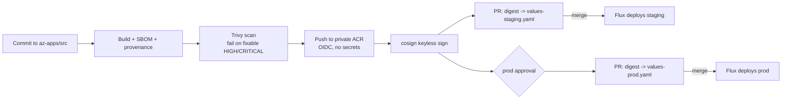

# Applications on AKS

How workloads get onto the `az-aks` clusters: a Helm chart with the platform defaults, namespace guardrails, a build pipeline that scans and signs images, and promotion by digest through GitOps.



## Layout

| Path | Contents |
|---|---|
| `src/web-app/` | Sample application (static site on unprivileged NGINX, base image pinned by digest) |
| `charts/web-app/` | Helm chart: Deployment, Service, HPA, PDB, Ingress with TLS, NetworkPolicy, optional ExternalSecret and workload identity |
| `charts/web-app/values-<env>.yaml` | Per-environment values; `image.digest` is what CI promotes |
| `platform/` | Kustomize base and overlays for the application namespace: Pod Security `restricted`, ResourceQuota, LimitRange, default-deny and DNS network policies |
| `deploy/<env>/` | Flux HelmRelease that installs the chart from this repository |
| `ci/` | GitLab pipeline and the promotion script shared by both CI systems |
| `tests/smoke.sh` | kind smoke test |

Flux applies `platform/overlays/<env>` and then `deploy/<env>` (see `az-aks/gitops/clusters/<env>/apps.yaml`).

## Chart defaults

| Concern | Default |
|---|---|
| Image | `repository@sha256:digest` only; the chart fails without a digest |
| Security context | non-root UID 10101 (`runAsUser`), read-only root file system, all capabilities dropped, `RuntimeDefault` seccomp, no privilege escalation |
| Service account | own account, token not mounted unless workload identity is used |
| Probes | startup, readiness and liveness on `/healthz` |
| Availability | rolling update with `maxUnavailable: 0`, zone and node topology spread, PDB, HPA on CPU |
| Network | ingress only from the application routing namespace, egress only DNS (add `networkPolicy.extraEgress`) |
| Ingress | application routing class, TLS from the `platform-internal` cert-manager issuer |
| Secrets | `externalSecret.data` maps Key Vault secrets to environment variables through the `azure-key-vault` ClusterSecretStore |

## CI

Both pipelines do the same: build, scan, push, sign, open a promotion request for staging, then wait for an approval before opening the prod request.

**GitHub Actions** (`.github/workflows/web-app.yml`): set repository or environment variables `AZURE_CLIENT_ID`, `AZURE_TENANT_ID`, `AZURE_SUBSCRIPTION_ID`, `REGISTRY_NAME` and `PUBLISH_RUNNER`. Add required reviewers to the `prod` environment.

**GitLab CI** (`ci/web-app.gitlab-ci.yml`, included by the root `.gitlab-ci.yml`): set the same variables scoped to environments, `GITLAB_TOKEN` (project access token, `api` scope) and `PUBLISH_RUNNER_TAG`. Protect the `prod` environment with approvals.

Azure access uses workload identity federation in both systems: create a user-assigned identity or app registration with a federated credential for the repository and environment (GitHub subject `repo:<org>/<repo>:environment:staging`, GitLab subject `project_path:<group>/<project>:ref_type:branch:ref:main`) and grant it `AcrPush` on the registry.

The registry has no public endpoint, so the push job needs a runner in a network that reaches the registry's private endpoint (a self-hosted runner in a peered spoke, or GitHub-hosted runners with Azure private networking). Build and scan run on hosted runners.

Images are signed keyless with cosign using the CI system's OIDC identity. Verify with:

```bash
cosign verify <registry>/web-app@sha256:<digest> \
  --certificate-identity-regexp '^https://github.com/<org>/<repo>/' \
  --certificate-oidc-issuer https://token.actions.githubusercontent.com
```

## Local checks

```bash
make k8s     # helm lint, render every values file, kubeconform, kustomize build
make smoke   # kind cluster: platform overlay, chart install, network policy and pod security checks
```

`make smoke` runs entirely in Docker (kind, kubectl and helm come from the tooling image). Set `SMOKE_KEEP=true` to keep the cluster for debugging.

## Adding an application

1. Copy `src/web-app` (or point the workflow at your own build context) and `deploy/<env>/web-app.yaml`.
2. Reuse `charts/web-app` with your own values files, or add a chart under `charts/`.
3. Add a namespace to `platform/base` if it needs its own quota and policies.
