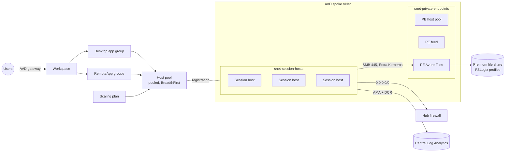

# Azure Virtual Desktop

A complete AVD workload on top of the landing zone: spoke network, host pool, application groups, workspace, scaling plan, FSLogix profile storage, session hosts and monitoring. Each deployment of `main.bicep` is one host pool; deploy it again with a different `workload` name for more pools.



## Prerequisites

- `az-landing-zone` deployed. Its outputs fill `hub`, `monitoring`, `baselineDataCollectionRuleResourceId` and `firewallPolicyResourceId`.
- Entra groups for users and administrators.
- The object ID of the **Azure Virtual Desktop** service principal in your tenant (application ID `9cdead84-a844-4324-93f2-b2e6bb768d07`), for the scaling plan and start VM on connect:
  `az ad sp show --id 9cdead84-a844-4324-93f2-b2e6bb768d07 --query id -o tsv`
- Resource providers `Microsoft.DesktopVirtualization`, `Microsoft.Compute`, `Microsoft.Storage`, `Microsoft.Insights`.
- Verify the image SKU exists in your region: `az vm image list-skus -l <region> -p MicrosoftWindowsDesktop -f windows-11 -o table`.

## Deploy

```bash
export AVD_LOCAL_ADMIN_PASSWORD='<from your vault>'   # never committed
az deployment sub create --location eastus --name avd-prod \
  --template-file az-avd/main.bicep --parameters az-avd/params/prod.bicepparam
```

### After the first deployment (Entra Kerberos)

1. Grant admin consent to the storage account's Entra application (Entra admin center > App registrations > `[Storage Account] <name>.file.core.windows.net` > API permissions). Without consent, Kerberos tickets can't be issued.
2. Exclude that application from Conditional Access policies that require MFA, as Microsoft documents for Azure Files.
3. Set NTFS permissions on the share root once (from an admin session host, as a member of the admin group): users need Modify on "this folder only", creator owner Modify on subfolders and files.

## Identity modes

| | EntraJoined (default) | DomainJoined |
|---|---|---|
| Directory | Microsoft Entra ID only | AD DS or Microsoft Entra Domain Services |
| Join | `AADLoginForWindows` extension, optional Intune enrollment | `JsonADDomainExtension` with the join account |
| Sign-in | Entra SSO (`enablerdsaadauth:i:1`), VM User/Administrator Login roles | Kerberos/NTLM to the domain; no VM login roles |
| FSLogix storage | Azure Files with Entra Kerberos (`AADKERB`) | `AADDS`, or `AD` with `activeDirectoryProperties` after an AD DS storage account join |
| Line of sight | None needed | Session hosts need DNS and network line of sight to domain controllers |
| Group Policy | No; use Intune | Yes |
| Trade-offs | Simplest, no domain controllers; apps that need Kerberos to on-premises servers require hybrid identities and cloud Kerberos trust | Supports legacy apps and GPO; adds domain controller dependency and a join credential to protect |

The domain join password is a `@secure()` parameter. Pass it from Key Vault with `az.getSecret()` in the parameter file or with an environment variable; it only reaches the VM in the extension's protected settings.

## Registration token

The host pool module asks for a new registration token on every deployment (`tokenValidityLength: PT4H`). The session host module reads it with `listRegistrationTokens()` during the same deployment and passes it only in the DSC extension's protected settings. The token never appears in outputs or in deployment history, and it expires four hours later. Redeploying is the rotation.

## Scaling

Pooled pools get a scaling plan with weekday and weekend schedules (ramp-up 07:00, peak 09:00, ramp-down 17:00, off-peak 20:00 on weekdays, in `scaling.timeZone`). Ramp-down waits for zero active sessions and never forces log-off. Tag a host with `scaling-exclude` to keep the plan away from it during maintenance.

## Monitoring

- Diagnostic settings (all logs) on the host pool, application groups, workspace, scaling plan, network and profile storage, all to the central workspace.
- Data collection rule `microsoft-avdi-<pool>` with the counters and events AVD Insights needs; associated with every host together with the landing zone's baseline Windows rule. Open **Azure Virtual Desktop > Insights** and pick the host pool to use the workbook.
- Alerts: no available hosts (Sev 1 in prod), unhealthy host, host near the session limit, FSLogix errors, profile storage latency above 50 ms, profile share above 80% of quota.

## Network

Session hosts have no public IPs. All egress goes through the hub firewall, and this deployment adds an AVD rule collection group to the hub policy:

| Rule | Destination | Port |
|---|---|---|
| Service tags | `WindowsVirtualDesktop`, `AzureMonitor`, `AzureActiveDirectory` | TCP 443 |
| Windows activation | `azkms.<storage suffix>`, `kms.<storage suffix>` | TCP 1688 |
| FQDN tags | `WindowsVirtualDesktop`, `WindowsUpdate`, `WindowsDiagnostics`, `MicrosoftActiveProtectionService` | 80, 443 |
| Certificate revocation | `oneocsp.microsoft.com`, `www.microsoft.com`, `ctldl.windowsupdate.com` | 80, 443 |
| Intune (when enabled) | `*.manage.microsoft.com`, `*.dm.microsoft.com`, `enterpriseregistration.windows.net` | 443 |

The full list is in [Required FQDNs and endpoints for Azure Virtual Desktop](https://learn.microsoft.com/azure/virtual-desktop/required-fqdn-endpoint). DNS (53) and NTP (123) are allowed by the hub's default rules. Private endpoints cover the host pool connection, the workspace feed and Azure Files. The global feed private endpoint (`privatelink-global.wvd.microsoft.com`) is one per tenant and belongs on a dedicated, empty workspace; it isn't created here.

## Staging vs prod

| | staging | prod |
|---|---|---|
| Hosts | 2 x D4ads_v5, no zones, StandardSSD | 6 x D8ads_v5 across zones 1-3, Premium SSD |
| Host pool | validation environment, DepthFirst, 8 sessions | BreadthFirst, 12 sessions |
| Profile storage | Premium_LRS, 100 GiB | Premium_ZRS, 1024 GiB |
| Scaling | minimum hosts 10% / 0% | 20% / 10% |
| Clipboard redirection | on | off |
| Alerts | Sev 3+ | Sev 1+ |
| Locks | none | CanNotDelete |

## Custom images

Set `sessionHosts.galleryImageResourceId` to an image definition (latest version) or version produced by `az-image-builder` (`workload/params/win11-avd.bicepparam`). To replace hosts with a new image, raise `sessionHosts.startIndex` past the current hosts and deploy, then drain and delete the old ones.

## Parameters

<!-- BEGIN_PARAMS -->
| Parameter | Type | Required | Default | Description |
|---|---|---|---|---|
| `environment` | environmentType | yes |  | Environment. |
| `location` | string | yes |  | Region for every regional resource. Also the metadata location of the host pool, application groups and workspace. |
| `workload` | string | no | `"avd"` | Workload name used in resource names. Use a different value per host pool. |
| `tags` | tagsType | yes |  | Tags applied to every resource. |
| `hub` | hubReferenceType | yes |  | Hub connection details (az-landing-zone output "hub"). |
| `monitoring` | monitoringReferenceType | yes |  | Central monitoring (az-landing-zone output "monitoring"). |
| `baselineDataCollectionRuleResourceId` | string | no | `""` | Baseline Windows VM data collection rule (az-landing-zone output vmDataCollectionRuleResourceIds.windows). |
| `firewallPolicyResourceId` | string | no | `""` | Hub firewall policy (az-landing-zone output firewallPolicyResourceId). When set, the AVD egress rules are added to it. |
| `firewallRulePriority` | int | no | `1000` | Priority of the AVD rule collection group in the hub firewall policy. |
| `network` | avdNetworkType | yes |  | Spoke network. |
| `hostPool` | hostPoolType | no | `{}` | Host pool settings. |
| `sessionHosts` | sessionHostsType | yes |  | Session hosts. |
| `sessionHostAdminPassword` | string (secure) | yes |  | Local administrator password for the session hosts. Pass it from Key Vault (az.getSecret) or an environment variable; never commit it. |
| `identity` | identityType | yes |  | Identity and access. |
| `domainJoinPassword` | string (secure) | no | `""` | Password of the domain join account (DomainJoined only). |
| `fslogix` | fslogixType | no | `{}` | FSLogix profile storage and configuration. |
| `applicationGroups` | applicationGroupType[] | no | see template | Application groups. Defaults to one desktop application group. |
| `workspaceFriendlyName` | string | no | `"Virtual Desktop"` | Workspace friendly name. |
| `scaling` | scalingType | no | `{}` | Scaling plan settings. |
| `enableAlerts` | bool | no | `true` | Email-free alerting: alerts use the landing zone action group from monitoring.actionGroupResourceId. |
| `enableTelemetry` | bool | no | `true` | Enable AVM usage telemetry. |

| Output | Type | Description |
|---|---|---|
| `hostPoolResourceId` | string | Resource ID of the host pool. |
| `workspaceResourceId` | string | Resource ID of the workspace. |
| `sessionHostNames` | string[] | Session host names. |
| `profileStorageAccountResourceId` | string | Resource ID of the FSLogix storage account, empty when disabled. |
| `virtualNetworkResourceId` | string | Resource ID of the spoke virtual network. |
<!-- END_PARAMS -->
