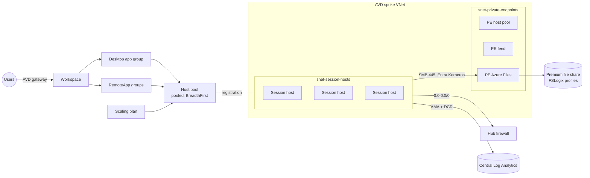

# Azure Virtual Desktop

A complete AVD workload on top of the landing zone: spoke network, host pool, application groups, workspace, scaling plan, FSLogix profile storage, session hosts and monitoring. Each deployment of `main.bicep` is one host pool; deploy it again with a different `workload` name for more pools.



## Prerequisites

- `az-landing-zone` deployed. Its outputs fill `hub`, `monitoring`, `baselineDataCollectionRuleResourceId` and `firewallPolicyResourceId`.
- Entra groups for users and administrators.
- The object ID of the **Azure Virtual Desktop** service principal in your tenant (application ID `9cdead84-a844-4324-93f2-b2e6bb768d07`), for the scaling plan and start VM on connect:
  `az ad sp show --id 9cdead84-a844-4324-93f2-b2e6bb768d07 --query id -o tsv`
- Resource providers `Microsoft.DesktopVirtualization`, `Microsoft.Compute`, `Microsoft.Storage`, `Microsoft.Insights`.
- Verify the image SKU exists in your region: `az vm image list-skus -l <region> -p MicrosoftWindowsDesktop -f windows-11 -o table`.

## Deploy

```bash
export AVD_LOCAL_ADMIN_PASSWORD='<from your vault>'   # never committed
az deployment sub create --location eastus --name avd-prod \
  --template-file az-avd/main.bicep --parameters az-avd/params/prod.bicepparam
```

### After the first deployment (Azure Files with Entra Kerberos)

These steps apply when `fslogix.storageType` is `AzureFiles` (the default) with `AADKERB`, for hybrid and cloud-only users alike. The storage account's Entra application is created automatically and named `[Storage Account] <account>.file.core.windows.net`. Don't change it beyond the documented edits below.

1. **Admin consent.** Entra admin center > App registrations > All applications > that application > API permissions > *Grant admin consent* for `openid`, `profile` and `User.Read`. Without consent, Kerberos tickets can't be issued.
2. **Conditional Access.** Exclude that application from every policy that requires MFA. Entra Kerberos for Azure Files can't satisfy MFA, and mounts fail with system error 1327.
3. **Application edits** (private link always, cloud-only groups for cloud-only users). Run [`scripts/Set-CloudOnlyKerberos.ps1`](scripts/Set-CloudOnlyKerberos.ps1) with `-WhatIf` first, then without it:
   ```powershell
   ./az-avd/scripts/Set-CloudOnlyKerberos.ps1 -StorageAccountName <account> -TenantId <tenant-id> -WhatIf
   ```
   It adds the `privatelink.file` identifier URIs (hosts reach the share through a private endpoint, and without them clients fall back to NTLM with error 1326). For cloud-only users it also adds the `kdc_enable_cloud_group_sids` tag (preview), which is mandatory: without it, cloud-only group SIDs are left out of tickets and share access fails. Use `-SkipCloudGroupTag` for hybrid-only tenants. The script needs Cloud Application Administrator (or `Application.ReadWrite.All`) and never runs as part of the deployment.
4. **App management policies.** If a tenant or app management policy blocks password credentials on service principals, or limits their lifetime to under 366 days, grant an exception for the *Storage Resource Provider* (app ID `a6aa9161-5291-40bb-8c5c-923b567bee3b`). Otherwise enabling Entra Kerberos fails with "The request to Microsoft Graph failed with code BadRequest".
5. **Root folder permissions.** FSLogix needs users to have Modify on the share root (this folder only) and creator owner Modify on subfolders and files.
   - Hybrid users: set them with `icacls` from a host with line of sight to a domain controller.
   - Cloud-only users: File Explorer can't set permissions for cloud-only identities. In the Azure portal, open the storage account > File shares > `profiles` > **Manage access** (shown once Entra Kerberos is configured) and add the users group and the admin group there.
6. **Client setting, if Intune manages hosts.** The FSLogix Run Command writes `CloudKerberosTicketRetrievalEnabled` and `LoadCredKeyFromProfile` itself. When `fslogix.configurationMethod` is `None`, set `Kerberos/CloudKerberosTicketRetrievalEnabled = 1` with an Intune **Settings Catalog** policy. The OMA-URI method doesn't work on multi-session hosts.

Share-level RBAC changes take up to 30 minutes, and group changes reach Kerberos tickets at the user's next sign-in.

### Entra Kerberos limits to know

- **Group SIDs.** A Kerberos ticket can carry at most 1,010 group SIDs, on-premises and cloud combined. Users above the limit sign in fine but can't mount the share; the Entra sign-in log shows error **140011 `KerberosUsersGroupNumberExceeded`**. Reduce their group memberships (nested and dynamic groups count).
- **Ticket lifetime.** Entra ID doesn't renew Kerberos TGTs, so a session that stays connected for about 10 hours can lose access to the share until the user signs out and in again. Entra-only clients have no workaround (cloud Kerberos trust needs AD DS). Size the pools' session limits and log-off policy with this in mind, or use `BlobCloudCache`.
- **Network changes.** Some network changes clear the cached KDC proxy configuration. Microsoft documents a *Specify KDC proxy servers for Kerberos clients* policy that keeps it.
- **Required services.** `WinHttpAutoProxySvc` and `iphlpsvc` must be running. The FSLogix Run Command checks both and fails the deployment if either is disabled. Neither the image builder's STIG scripts nor the STIG GPO package disable them. Disable WPAD through its registry setting if needed, never by disabling the service.

## Identity modes

`identity.mode` decides how hosts join a directory; `identity.userIdentitySource` says where user accounts live; `fslogix.storageType` picks the profile store.

| | EntraJoined, hybrid users (default) | EntraJoined, cloud-only users | Kerberos-free (`BlobCloudCache`) | DomainJoined |
|---|---|---|---|---|
| Settings | `mode: 'EntraJoined'` | `mode: 'EntraJoined'`, `userIdentitySource: 'CloudOnly'` | `fslogix.storageType: 'BlobCloudCache'` (any user source) | `mode: 'DomainJoined'` |
| Directory | Entra ID, users synced from AD DS | Entra ID only; no AD DS, no Entra Connect | Entra ID (or a domain, if domain joined) | AD DS or Microsoft Entra Domain Services |
| Join | `AADLoginForWindows`, optional Intune | `AADLoginForWindows`, optional Intune | As per `mode` | `JsonADDomainExtension` with the join account |
| Sign-in to AVD | Entra SSO (`enablerdsaadauth:i:1`) | Entra SSO | Entra SSO | Kerberos/NTLM to the domain |
| Profile store | Azure Files, Entra Kerberos (`AADKERB`) | Azure Files, Entra Kerberos with cloud-only group SIDs | Cloud Cache on page blobs, account key on each host | Azure Files with `AADDS`, or `AD` after an AD DS storage account join |
| Shared key access | Off | Off | **On** for this one account (tagged `shared-key-exception`) | Off |
| Clouds | All | Azure public cloud only (US Gov and China rejected by the template) | All | All |
| Client OS | Windows 11 multi-session, current updates | Windows 11 24H2/25H2 build `.8116` or later (KB5079391), 26H1 build 28000.1764 or later | Any supported | Any supported |
| Post-deploy steps | Consent, CA exclusion, private link URIs, `icacls` | Consent, CA exclusion, script (tag + URIs), **Manage access** | None for storage | AD DS storage account join (`AD`), `icacls` |
| Domain controllers | None needed (ACL changes need one) | None | None | Line of sight from hosts |
| Group Policy | No; use Intune | No; use Intune | As per `mode` | Yes |

The template rejects combinations that can't work before creating anything: cloud-only users with `DomainJoined`, cloud-only users with `AADDS`/`AD`, and cloud-only users on Azure Files in Azure US Government or China (`fail()` in `main.bicep`). Where share-level permissions are concerned, cloud-only users and groups can get per-identity RBAC in every Azure public region.

**AVD sign-in doesn't use Kerberos.** With `enablerdsaadauth:i:1`, the client authenticates to the Entra-joined host with Microsoft Entra ID (RDS AAD Auth), and the VM User/Administrator Login roles authorize it. Kerberos and domain controllers only matter for the profile share. With `BlobCloudCache`, no part of the sign-in or profile path uses Kerberos.

**Confirm the host build** (cloud-only): `Get-ItemProperty 'HKLM:\SOFTWARE\Microsoft\Windows NT\CurrentVersion' | Select CurrentBuildNumber, UBR` on a host; 26200 with UBR 8116 or higher is 25H2 with KB5079391. The FSLogix Run Command logs a warning when the build is older. For gallery images, check the build in the image builder's validation output before publishing.

The domain join password is a `@secure()` parameter. Pass it from Key Vault with `az.getSecret()` in the parameter file or with an environment variable; it only reaches the VM in the extension's protected settings.

## Kerberos-free profiles: Cloud Cache on blob storage

`fslogix.storageType: 'BlobCloudCache'` deploys a separate StorageV2 account (`...fslb...`, ZRS in prod) on a blob private endpoint in the hub `privatelink.blob` zone, with public network access off, and configures FSLogix Cloud Cache with a `type=azure` provider. Use it for Azure Government or China with cloud-only users, or to avoid Entra Kerberos and its limits altogether.

How the key is handled:
- The deployment reads the selected account key (`fslogix.blobKeyName`, default `key1`) with `listKeys()` and passes the connection string only as a **protected** Run Command parameter. It's never in parameters, outputs or deployment history.
- On each host, the Run Command stores it in Credential Manager with `frx.exe add-secure-key -key profiles-<key>` and `CCDLocations` references it as `connectionString="|fslogix/profiles-<key>|"`.

Trade-offs, accepted explicitly (D-025):
- This account has **shared key access on**. Anyone holding the key has full access to every profile in it. The account carries the tag `shared-key-exception: fslogix-cloud-cache`, which the governance policy treats as the approved exception.
- A local administrator on any session host can recover the key from Credential Manager. Treat host admin rights as equivalent to profile-store access: keep the admin group small and use the break-glass account only as documented.
- Profile access isn't per user. Isolation relies on FSLogix's own container naming, not on storage permissions.

**Rotate the key** without downtime: regenerate `key2` (`az storage account keys renew -g <rg> -n <account> --key secondary`), set `fslogix.blobKeyName: 'key2'` and redeploy (the Run Command re-runs because the key name changes, replaces the secure key and leaves profiles in place), then regenerate `key1`. Next time, go back the other way.

### Not used: Azure Files with managed identities

Azure Files SMB access with managed identities (OAuth over SMB) became generally available in 2026 Q2. It authenticates workloads (VMs, AKS pods) by their managed identity, not users, so it can't give each user their own profile container and isn't a fit for FSLogix profiles. It's noted here as a keyless option for application shares on Entra-joined hosts; nothing in this workload enables it.

## Registration token

The host pool module asks for a new registration token on every deployment (`tokenValidityLength: PT4H`). The session host module reads it with `listRegistrationTokens()` during the same deployment and passes it only in the DSC extension's protected settings. The token never appears in outputs or in deployment history, and it expires four hours later. Redeploying is the rotation.

## Scaling

Pooled pools get a scaling plan with weekday and weekend schedules (ramp-up 07:00, peak 09:00, ramp-down 17:00, off-peak 20:00 on weekdays, in `scaling.timeZone`). Ramp-down waits for zero active sessions and never forces log-off. Tag a host with `scaling-exclude` to keep the plan away from it during maintenance.

While session hosts deploy, the plan's host pool reference is turned off (`scalingPlanEnabled: false`) and a second deployment of the same plan turns it back on once every host has finished its Run Commands, so the plan can't stop or drain a host that is still being configured. Set `scaling.pauseDuringDeployment: false` to keep the plan on throughout. If a deployment fails between the two steps, the plan stays off until the next successful deployment.

## Monitoring

- Diagnostic settings (all logs) on the host pool, application groups, workspace, scaling plan, network and profile storage, all to the central workspace.
- Data collection rule `microsoft-avdi-<pool>` with the counters and events AVD Insights needs; associated with every host together with the landing zone's baseline Windows rule. Open **Azure Virtual Desktop > Insights** and pick the host pool to use the workbook.
- Alerts: no available hosts (Sev 1 in prod), unhealthy host, host near the session limit, FSLogix errors, profile storage latency above 50 ms, profile share above 80% of quota. The storage latency and quota alerts apply to the Azure Files store; Cloud Cache on blob storage has no quota, and FSLogix errors are still alerted from the hosts.
- Optional (`compliance`): daily compliance evidence in `AvdComplianceEvidence_CL` with a workbook, and AppLocker and Defender Antivirus events in `Event`, through a second rule `<pool>-dcr-security`. See [Host hardening](#host-hardening).

## Network

Session hosts have no public IPs. All egress goes through the hub firewall, and this deployment adds an AVD rule collection group to the hub policy:

| Rule | Destination | Port |
|---|---|---|
| Service tags | `WindowsVirtualDesktop`, `AzureMonitor`, `AzureActiveDirectory`, and `AzureAttestation` with Guest Attestation | TCP 443 |
| Windows activation | `azkms.<storage suffix>`, `kms.<storage suffix>` | TCP 1688 |
| FQDN tags | `WindowsVirtualDesktop`, `WindowsUpdate`, `WindowsDiagnostics`, `MicrosoftActiveProtectionService` | 80, 443 |
| Certificate revocation | `oneocsp.microsoft.com`, `www.microsoft.com`, `ctldl.windowsupdate.com` | 80, 443 |
| Intune (when enabled) | `*.manage.microsoft.com`, `*.dm.microsoft.com`, `enterpriseregistration.windows.net` | 443 |

The full list is in [Required FQDNs and endpoints for Azure Virtual Desktop](https://learn.microsoft.com/azure/virtual-desktop/required-fqdn-endpoint). DNS (53) and NTP (123) are allowed by the hub's default rules. Private endpoints cover the host pool connection, the workspace feed and the profile store (Azure Files, or blob for `BlobCloudCache`). The global feed private endpoint (`privatelink-global.wvd.microsoft.com`) is one per tenant and belongs on a dedicated, empty workspace; it isn't created here.

`useFirewallIpGroups: true` creates IP Groups for the session host and private endpoint subnets (`<pool>-ipg-session-hosts`, `-ipg-private-endpoints`) and sources every AVD rule from the session host group. Other workloads (for example rules that let session hosts reach an internal Git host) reference them through the `ipGroupResourceIds` output instead of repeating the prefixes (D-028).

## Staging vs prod

| | staging | prod |
|---|---|---|
| Hosts | 2 x D4ads_v5, no zones, StandardSSD | 6 x D8ads_v5 across zones 1-3, Premium SSD |
| Host pool | validation environment, DepthFirst, 8 sessions | BreadthFirst, 12 sessions |
| Profile storage | Premium_LRS, 100 GiB | Premium_ZRS, 1024 GiB |
| Scaling | minimum hosts 10% / 0% | 20% / 10% |
| Clipboard redirection | on | off |
| Alerts | Sev 3+ | Sev 1+ |
| Locks | none | CanNotDelete |

## Custom images

Set `sessionHosts.galleryImageResourceId` to an image definition (latest version) or version produced by `az-image-builder` (`workload/params/win11-avd.bicepparam`). To replace hosts with a new image, raise `sessionHosts.startIndex` past the current hosts and deploy, then drain and delete the old ones.

## Operations

Day-2 tasks for the FSLogix profile store. Scripts are in `scripts/`, queries in `kql/`.

### Share capacity

Premium Azure Files is billed on the provisioned quota (`fslogix.shareQuotaGiB`), not on usage, and the share alert fires at 80% of quota.

- **Resize by hand:** `scripts/Resize-FslogixShare.ps1 -ResourceGroupName <storage-rg> -StorageAccountName <account> -GrowPercent 25` (or `-QuotaGiB 2048`). It reads current usage, refuses a quota that leaves less than 10% free and supports `-WhatIf`.
- **Auto-grow:** `fslogix.autoGrow.enabled: true` deploys an Automation account (`<pool>-aa-fslogix`, local auth and public network access off) with a system-assigned identity holding Storage Account Contributor on the profile storage account, and an hourly schedule (`intervalHours`, default 6). ARM can't upload runbook content, so after the deployment publish the runbook and link it to the schedule:

  ```powershell
  $o = (Get-AzSubscriptionDeployment -Name <deployment>).Outputs.fslogixAutoGrow.Value
  ./scripts/Publish-FslogixAutoGrowRunbook.ps1 -ResourceGroupName $o.resourceGroupName.Value `
      -AutomationAccountName $o.automationAccountName.Value -ScheduleName $o.scheduleName.Value `
      -StorageAccountResourceId $o.storageAccountResourceId.Value -MaxQuotaGiB 4096
  ```

  The runbook (`scripts/runbooks/Invoke-FslogixShareAutoGrow.ps1`) grows the quota by 20% when usage reaches 80%, up to `MaxQuotaGiB`, and never shrinks it.
- **Both:** the deployment sets the quota from `fslogix.shareQuotaGiB` every time it runs, so after any grow update `shareQuotaGiB` in the parameter file. The script and the runbook output print the value to use. A deployment with a lower value tries to shrink the share; that fails if usage is above the new quota, and auto-grow grows it again otherwise.

### One user's profile container

Raising `fslogix.profileSizeInMBs` grows every user's container at next sign-in (FSLogix never shrinks a container). For one user only, sign the user out, then on a Windows machine that reaches the private endpoint (a drained session host works), as a local administrator with Storage File Data SMB Share Elevated Contributor:

```powershell
./scripts/Resize-FslogixProfile.ps1 -Path '\\<account>.file.<suffix>\profiles\<sid>_<user>\Profile_<user>.VHDX' -SizeGB 60
```

It stops if the container is attached, backs it up next to the original (`-SkipBackup` to skip), expands it with `diskpart expand vdisk`, attaches it to extend the volume and detaches it. Delete the backup after the user has signed in.

### Reports and queries

- `scripts/Get-FslogixProfileReport.ps1 -SharePath '\\<account>.file.<suffix>\profiles' -OutputPath profiles.csv`: every container with size, percent of the maximum, last write, stale flag (no write in 90 days) and whether it's attached.
- `kql/`: FSLogix errors by host and by message, sign-in duration per user, share requests, failures and throttling per hour, and 403s on the share. See `kql/README.md`.
- `fslogix.operationsWorkbook: true` deploys the **<pool> FSLogix operations** workbook with the same queries plus share used capacity, quota and server latency from Azure Monitor metrics.

### Removing stale containers

The report flags containers not written in 90 days. Delete them only after confirming the user has left (profile data can't be recovered once the share's 7-day soft delete expires); there is no automatic cleanup.

## Host hardening

These steps run on each host after registration and FSLogix, in this order. Each is a Run Command or extension in `modules/avd/session-hosts`.

| Step | Setting | Default |
|---|---|---|
| Guest Attestation extension (boot integrity monitoring, reported in Defender for Cloud) | `sessionHosts.guestAttestation` | on; adds `AzureAttestation` to the firewall rule |
| Deferred STIG settings: `C:\ProgramData\STIG\Apply-DeferredStigs.ps1 -Phase Deploy` | `sessionHosts.applyDeferredStigs` | on for Compute Gallery images, off for Marketplace images |
| Disable local administrators (V-253432), part of the STIG step | `sessionHosts.disableLocalAdministrators` | on |
| Windows LAPS break-glass account | `localAdmin.breakGlass` | off |
| Daily compliance evidence task | `compliance.evidence` | off |

`applyDeferredStigs` needs an image built by `az-image-builder` with the STIG package; the deployment is rejected when it's set without `galleryImageResourceId`, and the Run Command fails on a gallery image without the package. The STIG step renames the built-in administrator to `X_Admin`, denies it network logon and, with `disableLocalAdministrators`, disables every enabled local administrator, including `sessionHosts.adminUsername`. After that, sign-in uses Entra ID (or domain) accounts with the VM administrator login role; Run Command and Serial Console still work.

### Break-glass local administrator

`localAdmin.breakGlass.enabled: true` gives each host one local administrator managed by Windows LAPS automatic account management: LAPS creates the account (`accountName`, default `WLapsAdmin`), keeps it enabled, rotates its password every `passwordAgeDays` (default 30) and backs it up to Microsoft Entra ID (`backupDirectory: EntraID`, the default for Entra-joined hosts) or AD DS. After the account signs in, LAPS resets the password and signs it out once `postAuthenticationResetDelayHours` (default 8) have passed. It runs after the STIG step, so it is the one local administrator left enabled. Record it as an exception in the system security plan; whether it satisfies V-253432 is the assessor's call.

Requirements and how to use it:

- Windows 11 24H2 or later (automatic account management). The Run Command fails on older builds.
- Tenant setting: **Microsoft Entra ID > Devices > Device settings > Enable Microsoft Entra Local Administrator Password Solution (LAPS)** set to Yes.
- `configurationMethod`:
  - `RunCommand` (default without Intune) writes the Windows LAPS *Local Configuration* registry root (`HKLM\Software\Microsoft\Windows\CurrentVersion\LAPS\Config`) and processes it at once. Microsoft describes this root as primarily for testing and development, and LAPS ignores it when an Intune (CSP) or Group Policy LAPS policy is present. Use it only where neither exists.
  - `Intune` (default with `identity.intuneEnrollment`) writes nothing. Create one Intune policy (**Endpoint security > Account protection > Create policy**, platform **Windows**, profile **Local admin password solution (Windows LAPS)**) assigned to the host device group, with Backup Directory set to Microsoft Entra ID and the same age, length, complexity and post-authentication values. Intune's documentation says its LAPS policies manage an account that already exists rather than create one; if the profile in your tenant doesn't offer the Windows 11 24H2 automatic account management settings, create the account first (for example with an Intune script) and set **Administrator Account Name** to it. Intune lists Endpoint security profiles for the Windows platform as supported on multi-session hosts.
  - Domain-joined hosts back up to Entra ID only when they're hybrid joined; otherwise set `backupDirectory: ActiveDirectory` (or use the LAPS Group Policy).
- Reading the password needs `microsoft.directory/deviceLocalCredentials/password/read`, held by the Cloud Device Administrator role, or a custom role with that permission. Make that role eligible through PIM rather than standing. Retrieve it in **Entra ID > Devices > Local administrator password recovery**, in Intune (device > Local admin password), or with Microsoft Graph (`deviceLocalCredentials`, base64-encoded).
- The backed-up password is deleted with the device object, so retrieve it before deleting a host from Entra ID.
- Local accounts are denied network logon by the STIG baseline, so use the account through the Serial Console or a Bastion console session where policy allows local interactive sign-in.

### Compliance evidence

`compliance.evidence: true` installs a scheduled task (`\AVD\AVD compliance evidence`, SYSTEM, daily at `compliance.dailyAt`) that appends JSON lines to `C:\ProgramData\STIG\evidence\compliance-<date>.json`. The second data collection rule sends them to the custom table `AvdComplianceEvidence_CL` in the central workspace (created by the deployment), and the **<pool> session host compliance** workbook shows status by host, failing checks and hosts that stopped reporting. Each run records:

- whether the deploy-time STIG step ran,
- each deferred registry policy and security template setting against the host's current value,
- AppLocker enforcement mode per rule collection, Defender real-time protection and signature age,
- optionally, rule results from an XCCDF file written by a SCAP scanner already on the image (`compliance.scapCommand`, `scapArguments`, `scapResultsPath`). No scanner is installed by this repo.

This is configuration evidence for review. It doesn't establish compliance on its own, and it only covers the settings listed. Custom log collection needs a data collection endpoint (`monitoring.dataCollectionEndpointResourceId`); the deployment is rejected without one.

`compliance.securityEvents: true` adds AppLocker (all four logs, warnings and errors: audit hits and blocks) and Defender Antivirus (`Microsoft-Windows-Windows Defender/Operational`, warnings, errors and 5007 configuration changes) to the `Event` table. AppLocker logs are verbose; the filter keeps only warnings and errors as Microsoft recommends for forwarding.

## Parameters

<!-- BEGIN_PARAMS -->
| Parameter | Type | Required | Default | Description |
|---|---|---|---|---|
| `environment` | environmentType | yes |  | Environment. |
| `location` | string | yes |  | Region for every regional resource. Also the metadata location of the host pool, application groups and workspace. |
| `workload` | string | no | `"avd"` | Workload name used in resource names. Use a different value per host pool. |
| `tags` | tagsType | yes |  | Tags applied to every resource. |
| `hub` | hubReferenceType | yes |  | Hub connection details (az-landing-zone output "hub"). |
| `monitoring` | monitoringReferenceType | yes |  | Central monitoring (az-landing-zone output "monitoring"). |
| `baselineDataCollectionRuleResourceId` | string | no | `""` | Baseline Windows VM data collection rule (az-landing-zone output vmDataCollectionRuleResourceIds.windows). |
| `firewallPolicyResourceId` | string | no | `""` | Hub firewall policy (az-landing-zone output firewallPolicyResourceId). When set, the AVD egress rules are added to it. |
| `firewallRulePriority` | int | no | `1000` | Priority of the AVD rule collection group in the hub firewall policy. |
| `useFirewallIpGroups` | bool | no | `false` | Create Azure Firewall IP Groups for the session host and private endpoint subnets, and use them as the source of the AVD rules instead of literal prefixes. Defaults to false. |
| `network` | avdNetworkType | yes |  | Spoke network. |
| `hostPool` | hostPoolType | no | `{}` | Host pool settings. |
| `sessionHosts` | sessionHostsType | yes |  | Session hosts. |
| `sessionHostAdminPassword` | string (secure) | yes |  | Local administrator password for the session hosts. Pass it from Key Vault (az.getSecret) or an environment variable; never commit it. |
| `identity` | identityType | yes |  | Identity and access. |
| `domainJoinPassword` | string (secure) | no | `""` | Password of the domain join account (DomainJoined only). |
| `fslogix` | fslogixType | no | `{}` | FSLogix profile storage and configuration. |
| `applicationGroups` | applicationGroupType[] | no | see template | Application groups. Defaults to one desktop application group. |
| `workspaceFriendlyName` | string | no | `"Virtual Desktop"` | Workspace friendly name. |
| `scaling` | scalingType | no | `{}` | Scaling plan settings. |
| `localAdmin` | localAdminType | no | `{}` | Local administrator settings: a Windows LAPS-managed break-glass account. |
| `compliance` | complianceType | no | `{}` | Compliance evidence and AppLocker and Defender event collection. |
| `enableAlerts` | bool | no | `true` | Email-free alerting: alerts use the landing zone action group from monitoring.actionGroupResourceId. |
| `enableTelemetry` | bool | no | `true` | Enable AVM usage telemetry. |

| Output | Type | Description |
|---|---|---|
| `hostPoolResourceId` | string | Resource ID of the host pool. |
| `workspaceResourceId` | string | Resource ID of the workspace. |
| `sessionHostNames` | string[] | Session host names. |
| `profileStorageAccountResourceId` | string | Resource ID of the FSLogix storage account (file share or Cloud Cache blob account), empty when disabled. |
| `virtualNetworkResourceId` | string | Resource ID of the spoke virtual network. |
| `ipGroupResourceIds` | object | Resource IDs of the firewall IP Groups (sessionHosts, privateEndpoints), empty when useFirewallIpGroups is false. |
| `complianceWorkbookResourceId` | string | Resource ID of the session host compliance workbook, empty when compliance.evidence is false. |
| `fslogixAutoGrow` | object | Values for scripts/Publish-FslogixAutoGrowRunbook.ps1, empty when fslogix.autoGrow is off. |
<!-- END_PARAMS -->
