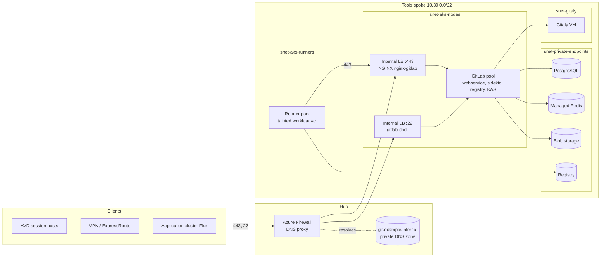

# GitLab on AKS

Self-managed GitLab, internal only, on an AKS cluster from `az-aks`, with its data on Azure services: Azure Database for PostgreSQL, Azure Managed Redis and Blob Storage, all on private endpoints. Prod runs on a dedicated tools cluster in its own spoke. Staging can share the application cluster (`placement`, D-033).

This folder has two parts:

- `main.bicep` (subscription scope) deploys the Azure side: data services, identities, the Gitaly VM, DNS records and hub firewall rules.
- `gitops/` holds the cluster side (namespaced resources only), which the cluster's Flux reconciles. It reuses the platform's External Secrets Operator, cert-manager issuer and Flux; it doesn't install its own.



## What it deploys

| Area | Choice |
|---|---|
| Database | PostgreSQL flexible server 17, private endpoint, password and Entra auth, TLS required, `amcheck`, `btree_gist`, `pg_trgm` and `pg_stat_statements` allowed. Zone-redundant HA and 35-day backups in prod. |
| Cache | Azure Managed Redis, TLS on port 10000, one endpoint (EnterpriseCluster policy). The access key is written to Key Vault (`gitlab-redis-password`) and never output. |
| Object storage | One storage account, shared key access off, private endpoint, containers for artifacts, LFS, uploads, packages, MR diffs, Terraform state, secure files, dependency proxy, registry and backups. GitLab reaches it with workload identity (`gitlab` service account). |
| Gitaly | Prod: Gitaly on a VM (Ubuntu 24.04, trusted launch, premium repository disk that outlives the VM, Entra SSH, Azure Monitor Agent) configured by a run command. Staging: Gitaly StatefulSet on premium disks. See D-033. |
| Access | Internal only. HTTPS through a dedicated application routing NGINX controller (`nginx-gitlab`, internal LB on a fixed IP). Git over SSH through a second internal LB (the only LoadBalancer Service outside `app-routing-system`, a D-023 exception for the `gitlab` namespace). Records in a private zone linked to the hub, resolved through the firewall DNS proxy. |
| Firewall | Clients (AVD session host IP Group, VPN or ExpressRoute ranges, the application cluster for Flux) to both LBs on 443 and 22. Runner nodes to the push registries' private endpoints on 443. Gitaly VM to the GitLab package repository. |
| Runners | Kubernetes executor, jobs in `ci-jobs` on the tainted runner pool (own subnet, IP Group and an empty egress allowlist), unprivileged, `ci-job` service account with workload identity and AcrPush. Job images only from the private registry. |
| Identity | Entra ID sign-in (OpenID Connect). Optional Keycloak (D-034). |
| Backups | Toolbox backup CronJob to the backups container, plus Key Vault copies of the secrets backups don't contain. PostgreSQL point-in-time restore and Gitaly disk snapshots on top. |
| Monitoring | Managed Prometheus ServiceMonitors and PodMonitors (azmonitoring.coreos.com), Grafana dashboards in `gitops/dashboards`. |

## Placement

| | Dedicated (prod default) | Shared (staging default) |
|---|---|---|
| Cluster | `az-aks` with `params/tools-prod.bicepparam` (`workload: 'tools'`) | The environment's application cluster, with a gitlab and a runner pool added |
| Network | Own spoke, own IP Groups, own firewall rule collection groups | The application spoke; GitLab shares its egress rules |
| Blast radius | A GitLab upgrade or runaway job can't affect applications | Jobs and GitLab compete with applications for nodes, quota and the API server |
| Cost | A second cluster (control plane, system pool, Grafana) | No extra cluster |

Shared mode is meant for staging and evaluation. CI jobs build and run untrusted code, so prod keeps them off the application cluster (D-033).

## Bootstrap order

GitLab can't host the Git repository that deploys GitLab, so the tools cluster starts on hosted Git:

1. **Landing zone.** Add the GitLab zone, `privatelink.postgres.database.azure.com` and `privatelink.redis.azure.net` to `additionalPrivateDnsZones` (already in the landing zone params) and redeploy.
2. **Tools cluster.** Deploy `az-aks` with `params/tools-prod.bicepparam`. Its `gitOps.repositoryUrl` points at the hosted Git repository. Fill `clusters/tools-prod/cluster-settings.yaml` from the outputs.
3. **Secrets.** `scripts/seed-secrets.sh <tools key vault>`, then export `GITLAB_POSTGRES_PASSWORD`, `GITLAB_GITALY_TOKEN` and `GITLAB_SHELL_SECRET` from the vault for the deployment.
4. **Azure side.** Deploy this template:
   ```bash
   az deployment sub create --location eastus --name gitlab-prod \
     --template-file az-gitlab/main.bicep --parameters az-gitlab/params/prod.bicepparam
   ```
5. **Cluster side.** `scripts/write-gitlab-settings.sh gitlab-prod tools-prod`, and `scripts/import-runner-images.sh <tools registry>`. Commit and push. Flux installs GitLab (about 20 minutes on first install).
6. **After the first install.**
   - Run `scripts/backup-gitlab-secrets.sh <tools key vault>`.
   - Set `gitaly.trustedCaPem` to the platform CA (`kubectl -n gitlab get secret gitlab-tls -o jsonpath='{.data.ca\.crt}' | base64 -d`) and redeploy, so the Gitaly VM trusts GitLab's certificate.
   - Sign in as root (`kubectl -n gitlab get secret gitlab-gitlab-initial-root-password -o jsonpath='{.data.password}' | base64 -d`), set up Entra sign-in, then block or rotate root.
   - Create the instance runner and store its token: `az keyvault secret set --vault-name <kv> -n gitlab-runner-token --value glrt-...`.
7. **Move Flux to GitLab.** Push this repository to GitLab and create a project deploy token with `read_repository`. Then, for each cluster, change `gitOps.repositoryUrl` in its `az-aks` params to the GitLab URL and redeploy. The Flux extension takes HTTPS credentials through `configurationProtectedSettings`; put the token in Key Vault, not in the params file. The application cluster reaches GitLab through the firewall rule from its node IP Group.

**Fallback to hosted Git.** Keep the hosted repository as a push mirror of the GitLab project (GitLab **Settings > Repository > Mirroring repositories**). If GitLab is down, point `gitOps.repositoryUrl` back at the mirror and redeploy `az-aks`. The tools cluster itself always follows the hosted repository, so it can rebuild GitLab without GitLab.

## Entra ID sign-in

1. Create an app registration: single tenant, web redirect URI `https://gitlab.<zone>/users/auth/openid_connect/callback`.
2. Add a client secret. Grant delegated Microsoft Graph `openid`, `profile` and `email` with admin consent.
3. In the enterprise application, set **Assignment required** to Yes and assign the groups that may use GitLab. Assignment is the access control (`blockAutoCreatedUsers: false`).
4. Store the provider configuration:
   ```bash
   GITLAB_OIDC_CLIENT_SECRET=<secret> az-gitlab/scripts/seed-secrets.sh <kv> \
     --oidc-client-id <application id> --oidc-tenant-id <tenant id> --gitlab-url https://gitlab.<zone>
   ```
   GitLab picks it up when ESO refreshes the secret (hourly) and the webservice pods restart.

Users are matched on the Entra object ID (`uid_field: oid`), so renames don't create new accounts. Group sync and admin mapping need GitLab Premium SAML group links or SCIM; they aren't set up here.

## Building images

Jobs run unprivileged without Docker-in-Docker. Build images with a rootless builder in the job image (BuildKit rootless or Buildah), as the pipelines in `az-apps/ci` do. Push with the job's workload identity: `az acr login --name <registry> --expose-token` exchanges the federated token for a registry token. Runners can push to the tools registry and, through the firewall, to the registries in `runners.pushRegistryResourceIds` (D-022).

Keyless cosign signing (D-022) relies on the public Sigstore Fulcio accepting the CI OIDC issuer. A self-hosted GitLab issuer on a private zone isn't reachable from Fulcio, so GitLab pipelines need key-based signing (a cosign key in Key Vault, `azurekms://`). The image verification policy then needs a key attestor (B-028).

## Backup and restore

| What | How | Retention |
|---|---|---|
| Database | PostgreSQL automated backups, point in time | 35 days prod, 7 staging |
| Repositories, uploads, CI data | Toolbox backup CronJob (`gitlab-backup create`) to the `gitlab-backups` container; daily in prod, weekly in staging | Blob soft delete and a lifecycle rule you add for the container |
| Object storage | Blob soft delete and versioning (prod) | 30 days prod, 7 staging |
| Secrets the backup doesn't contain | `scripts/backup-gitlab-secrets.sh` copies the Rails secrets and SSH host keys to Key Vault | Key Vault soft delete, 90 days |
| Gitaly VM disk (prod) | The repository disk survives VM deletion; add disk snapshots (Azure Backup for disks) if you need a recovery point between GitLab backups | |

Restore test, at least once a quarter, in staging or a scratch cluster:

1. Deploy `az-gitlab` and the cluster side into the test environment.
2. Before Flux installs the chart, run `scripts/restore-gitlab-secrets.sh <test kv>` with the source environment's secrets (copy them across vaults), so the Rails secrets match the backup.
3. Copy a backup archive from the source `gitlab-backups` container to the test one.
4. Scale down the writers and restore:
   ```bash
   kubectl -n gitlab scale deploy -l app=sidekiq --replicas=0
   kubectl -n gitlab scale deploy -l app=webservice --replicas=0
   kubectl -n gitlab exec deploy/gitlab-toolbox -- backup-utility --restore -t <backup id>
   ```
5. Scale back up, sign in, open a few projects, clone over SSH and HTTPS, and run a pipeline.
6. Record the backup ID, the time the restore took and the result.

## Monitoring

`gitops/base/monitoring.yaml` scrapes webservice (Puma and Workhorse), sidekiq, the exporter, gitlab-shell, the registry, Gitaly and the runner manager into the cluster's Azure Monitor workspace. In prod, Gitaly on the VM is scraped through a selector-less Service. `scripts/import-dashboards.sh <grafana resource id>` imports the overview, Gitaly and runner dashboards.

## Optional components

| Component | Where | Turn on |
|---|---|---|
| Keycloak (D-034) | `gitops/optional/keycloak` | `keycloak.enabled: true` here (database), `seed-secrets.sh --keycloak`, then add the directory to the cluster's GitLab Kustomization |
| Image signature verification | `az-aks/gitops/optional/image-verification` | `az-aks` `addons.imageVerification` |
| AKS Backup | `az-aks` `addons.backup` | see the az-aks README |
| external-dns | `az-aks/gitops/optional/external-dns` | `az-aks` `addons.externalDnsZoneNames` |
| Trivy Operator | `az-aks/gitops/optional/trivy-operator` | add to the cluster |
| GitHub Actions Runner Controller | `az-aks/gitops/optional/actions-runner-controller` | add to the cluster, store the GitHub App in Key Vault |

## Validation

`make k8s` builds every overlay. `make rendered` renders both overlays the way the cluster sees them (Flux substitution from the cluster's settings, then `helm template` for each HelmRelease) and checks them: schema validation, every LoadBalancer internal and only in `gitlab`, every Ingress on an internal controller, no privileged containers, and runner jobs unprivileged on the CI pool. `make deployments` checks the address plan, the runner pool and the private endpoints of the data services.

## Parameters

<!-- BEGIN_PARAMS -->
| Parameter | Type | Required | Default | Description |
|---|---|---|---|---|
| `environment` | environmentType | yes |  | Environment. |
| `location` | string | yes |  | Region. Must be the cluster region. |
| `workload` | string | no | `"gitlab"` | Workload name used in resource names. |
| `tags` | tagsType | yes |  | Tags applied to every resource. |
| `placement` | `Dedicated` \| `Shared` | no | computed | Dedicated (prod default: a separate tools cluster in its own spoke) or Shared (staging default: tainted pools on the application cluster, to save cost). Only changes defaults and the documented trade-offs; the cluster reference decides where GitLab runs. |
| `hub` | hubReferenceType | yes |  | Hub connection details (az-landing-zone output "hub"). The private DNS zones and the GitLab zone are in its DNS resource group. |
| `monitoring` | monitoringReferenceType | yes |  | Central monitoring (az-landing-zone output "monitoring"). |
| `firewallPolicyResourceId` | string | no | `""` | Hub firewall policy (az-landing-zone output firewallPolicyResourceId). When set, client, runner and Gitaly rules are added to it. |
| `cluster` | clusterReferenceType | yes |  | The cluster GitLab runs on (az-aks outputs). |
| `dns` | gitlabDnsType | yes |  | Host names and internal load balancer addresses. |
| `postgres` | gitlabPostgresType | no | `{}` | PostgreSQL settings. |
| `postgresAdministratorPassword` | string (secure) | yes |  | PostgreSQL administrator password. Generated by scripts/seed-secrets.sh into the cluster key vault and read with getSecret() in the parameter file. |
| `redis` | gitlabRedisType | no | `{}` | Managed Redis settings. |
| `gitaly` | gitalyType | no | `{}` | Gitaly placement. |
| `gitalyAuthToken` | string (secure) | no | `""` | gitaly.mode VirtualMachine: Gitaly token (seeded in the cluster key vault). |
| `gitlabShellSecret` | string (secure) | no | `""` | gitaly.mode VirtualMachine: GitLab Shell secret (seeded in the cluster key vault). |
| `access` | gitlabAccessType | no | `{}` | Who may reach GitLab through the hub firewall. |
| `runners` | gitlabRunnersType | no | `{}` | CI runner settings. |
| `keycloak` | keycloakType | no | `{}` | Keycloak identity broker (off by default). |
| `keycloakDatabasePassword` | string (secure) | no | `""` | keycloak.enabled: password of the Keycloak database administrator (seeded in the cluster key vault). |
| `enableTelemetry` | bool | no | `true` | Enable AVM usage telemetry. |

| Output | Type | Description |
|---|---|---|
| `placement` | string | Placement used for defaults (Dedicated or Shared). |
| `resourceGroupName` | string | Resource group of the GitLab data services. |
| `gitlabClientId` | string | Client ID of the GitLab workload identity (service account gitlab/gitlab). |
| `ciClientId` | string | Client ID of the CI job identity (service account ci-jobs/ci-job). |
| `storageAccountName` | string | Storage account for object storage and backups. |
| `postgresHost` | string | PostgreSQL host name. |
| `postgresUser` | string | PostgreSQL user GitLab connects as. |
| `redisHost` | string | Redis host name (TLS, port 10000). |
| `gitalyMode` | string | Gitaly mode. |
| `gitalyAddress` | string | Gitaly VM address, empty for the StatefulSet mode. |
| `keycloakDatabaseHost` | string | Keycloak database host, empty when Keycloak is off. |
| `gitlabUrl` | string | GitLab URL. |
| `clusterResourceGroupName` | string | Cluster resource group (where the Kubernetes side runs). |
| `gitlabSettings` | object | Non-secret values for the gitlab-settings ConfigMap that Flux substitutes into az-gitlab/gitops (scripts/write-gitlab-settings.sh). The chart uses the default host labels (gitlab, registry, kas, ssh). |
<!-- END_PARAMS -->
