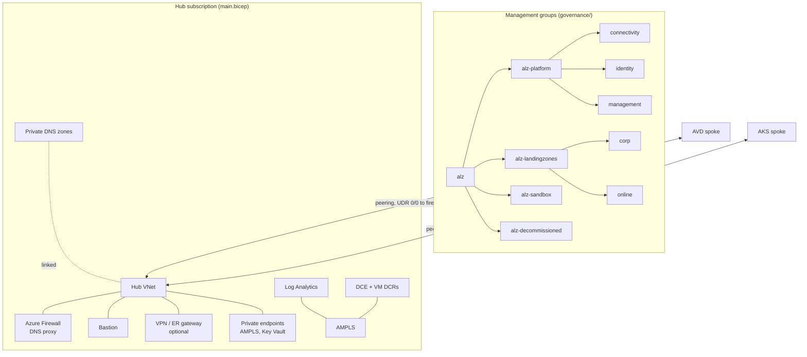

# Landing zone

The platform layer every workload attaches to. It has two deployments:

| Deployment | Scope | What it creates |
|---|---|---|
| `governance/` | Management group (parent of the hierarchy) | Management groups, subscription placement, baseline Azure Policy |
| `main.bicep` | Subscription (connectivity + management) | Hub network, firewall, Bastion, private DNS, Log Analytics, AMPLS, data collection, Key Vault, Defender, budget |




## Deploy

Order: governance, then the hub, then governance again with the hub outputs so the DeployIfNotExists policies have a workspace to target.

```bash
# 1. Management groups and baseline policy (needs Owner or Management Group Contributor
#    + Resource Policy Contributor at the parent management group)
az deployment mg create --management-group-id <tenant-root-or-parent> --location eastus \
  --name governance --template-file az-landing-zone/governance/main.bicep \
  --parameters az-landing-zone/governance/params/prod.bicepparam

# 2. Hub (in the connectivity/management subscription)
az deployment sub create --location eastus --name landing-zone \
  --template-file az-landing-zone/main.bicep --parameters az-landing-zone/params/prod.bicepparam

# 3. Copy outputs into governance/params/prod.bicepparam
#    (logAnalyticsWorkspaceResourceId, vmDataCollectionRuleResourceId, vmMonitoringIdentityResourceId)
#    and run step 1 again.
```

`staging` builds a separate canary management group hierarchy (`alz-canary-*`) with policies in audit-only mode, and a separate hub (`10.100.0.0/22`). Test policy and network changes there first.

## Outputs consumed by workloads

| Output | Used by |
|---|---|
| `hub` (`hubReferenceType`) | `az-avd`, `az-aks`: spoke peering, default route, DNS through the firewall |
| `monitoring` (`monitoringReferenceType`) | every workload: diagnostic settings, DCR destinations, alert action group |
| `firewallPolicyResourceId` | workloads add their own rule collection group to the hub policy |
| `vmDataCollectionRuleResourceIds` | governance VM monitoring policy, AVD session hosts |
| `keyVaultResourceId`, `encryptionIdentityResourceId` | customer-managed keys |

## Environment differences

| Setting | staging | prod |
|---|---|---|
| Firewall | Standard, no zones, IDPS n/a | Premium, zones 1-3, IDPS Deny |
| Bastion | Basic | Standard, copy/paste off |
| Log Analytics | 30 days, 5 GB/day cap | 365 days, no cap, replicated |
| Key Vault | standard | premium (HSM keys) |
| Defender for Cloud | CSPM only | Servers P2, Storage (malware scan), Key Vault, ARM, Containers, DNS |
| Locks | none | CanNotDelete on every resource group and resource |
| Policy enforcement | DoNotEnforce (audit) | Default |

## Design notes

- **DNS.** The firewall policy enables DNS proxy. Spokes use the firewall IP as their DNS server, the firewall forwards to Azure DNS in the hub, and the hub VNet is linked to every private DNS zone. No zone links per spoke are needed.
- **Egress.** Spokes send `0.0.0.0/0` to the firewall. The default rule groups (`config/firewall-rules/`) allow DNS, NTP, Windows Update and Azure Monitor from internal ranges. Workloads add their own rule collection groups (AVD and AKS required FQDNs).
- **Monitoring.** Ingestion is private only, through AMPLS. Queries stay open by default so the portal works off-network; set `monitoring.publicNetworkAccessForQuery` and `amplsQueryAccessMode` to lock them down.
- **Policy.** The governance deployment assigns built-in definitions only. For the full Azure Landing Zones policy set (custom definitions such as Deny-Subnet-Without-Nsg), use the [ALZ library](https://github.com/Azure/Azure-Landing-Zones-Library) through the ALZ Bicep accelerator on top of this hierarchy; the management group IDs match its archetypes.

## Parameters

<!-- BEGIN_PARAMS -->
| Parameter | Type | Required | Default | Description |
|---|---|---|---|---|
| `environment` | environmentType | yes |  | Environment. Drives SKU, redundancy, retention and lock defaults. |
| `location` | string | yes |  | Region for every regional resource. |
| `workload` | string | no | `"hub"` | Workload name used in resource names. |
| `tags` | tagsType | yes |  | Tags applied to every resource. |
| `network` | hubNetworkType | yes |  | Hub network layout. |
| `firewall` | firewallType | no | `{}` | Azure Firewall settings. |
| `bastionSku` | `Basic` \| `Premium` \| `Standard` | no | `"Standard"` | Bastion SKU. Defaults to Standard. |
| `gateway` | gatewayType | no | `{"type":"None"}` | Hybrid connectivity gateway. Defaults to none. |
| `enableDdosProtection` | bool | no | `false` | Deploy a DDoS Network Protection plan and associate it with the hub. Defaults to false (the plan has a significant fixed monthly cost). |
| `monitoring` | monitoringType | no | `{}` | Central monitoring settings. |
| `keyVault` | keyVaultType | no | `{}` | Platform Key Vault settings. |
| `budget` | budgetType | no |  | Monthly budget. Omit to skip. |
| `defender` | defenderType | no |  | Microsoft Defender for Cloud settings. Omit to leave Defender unchanged. |
| `additionalPrivateDnsZones` | string[] | no | `[]` | Private DNS zones in addition to the defaults (Azure Monitor, Key Vault, Storage, AVD, ACR, AKS, Grafana). |
| `enableTelemetry` | bool | no | `true` | Enable AVM usage telemetry. |
| `deploymentTime` | string | no | computed | Generated. Do not set. Used for the budget start date. |

| Output | Type | Description |
|---|---|---|
| `hub` | hubReferenceType | Hub reference for spoke deployments (hubReferenceType). |
| `monitoring` | monitoringReferenceType | Monitoring reference for workload deployments (monitoringReferenceType). |
| `firewallPolicyResourceId` | string | Resource ID of the hub firewall policy. Workloads add their own rule collection groups to it. |
| `vmDataCollectionRuleResourceIds` | object | Resource IDs of the baseline VM data collection rules, keyed by OS. |
| `keyVaultResourceId` | string | Resource ID of the platform Key Vault, empty when disabled. |
| `encryptionIdentityResourceId` | string | Resource ID of the user-assigned identity used for customer-managed key access. |
<!-- END_PARAMS -->
