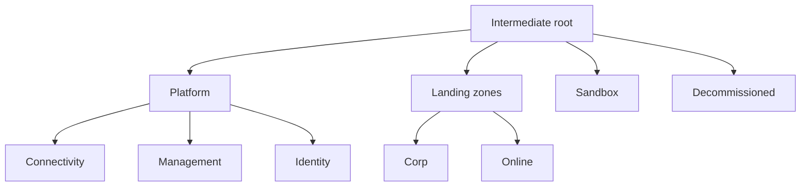

# Governance

Management group hierarchy, subscription placement and baseline policy assignments, deployed at management group scope (normally the tenant root group or a dedicated intermediate root). Deploy it before `az-landing-zone/main.bicep`.



The staging parameter file deploys a parallel canary hierarchy (prefix `alz-canary`) with assignments in `DoNotEnforce`, so policy changes are tried there before prod. Baseline assignments are Microsoft built-ins: Microsoft cloud security benchmark, allowed locations, required and inherited tags, diagnostic settings to the central workspace, VM monitoring, no public IPs on NICs and secure transfer for storage. See D-010 in `docs/DECISIONS.md`.

```bash
az deployment mg create --management-group-id <root-mg-id> --location eastus \
  --template-file az-landing-zone/governance/main.bicep \
  --parameters az-landing-zone/governance/params/prod.bicepparam
```

## Parameters

<!-- BEGIN_PARAMS -->
| Parameter | Type | Required | Default | Description |
|---|---|---|---|---|
| `environment` | environmentType | yes |  | Environment. prod builds the live hierarchy; staging builds a separate canary hierarchy to test policy changes first. |
| `prefix` | string | no | computed | Prefix for management group IDs. Defaults to alz (prod) or alz-canary (staging). |
| `rootDisplayName` | string | no | computed | Display name of the intermediate root management group. |
| `location` | string | yes |  | Deployment metadata location and location of policy assignment identities. |
| `allowedLocations` | string[] | yes |  | Regions where resources and resource groups may be created. |
| `requiredResourceGroupTags` | string[] | no | `["environment","workload"]` | Tags every resource group must carry. |
| `logAnalyticsWorkspaceResourceId` | string | no | `""` | Resource ID of the central Log Analytics workspace. When set, diagnostic settings and activity log policies are assigned. Deploy the landing zone first, then redeploy governance with this value. |
| `vmDataCollectionRuleResourceId` | string | no | `""` | Resource ID of the Windows VM data collection rule from the landing zone. With vmMonitoringIdentityResourceId, assigns the Azure Monitor Agent policy to landing zones. |
| `vmMonitoringIdentityResourceId` | string | no | `""` | Resource ID of the user-assigned identity the Azure Monitor Agent uses (the landing zone logging identity). |
| `enforcementMode` | `Default` \| `DoNotEnforce` | no | computed | Policy enforcement. Defaults to Default (enforced) in prod and DoNotEnforce (audit only) in staging. |
| `subscriptionPlacement` | object | no | `{}` | Subscription IDs to place under each management group, keyed by short name (platform, connectivity, identity, management, corp, online, sandbox, decommissioned). |
| `enableTelemetry` | bool | no | `true` | Enable AVM usage telemetry. |

| Output | Type | Description |
|---|---|---|
| `managementGroupIds` | object | Management group IDs keyed by short name. |
<!-- END_PARAMS -->
