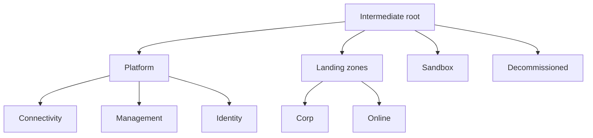

# Governance

Management group hierarchy, subscription placement and baseline policy assignments, deployed at management group scope (normally the tenant root group or a dedicated intermediate root). Deploy it before `az-landing-zone/main.bicep`.



The staging parameter file deploys a parallel canary hierarchy (prefix `alz-canary`) with assignments in `DoNotEnforce`, so policy changes are tried there before prod. Baseline assignments are Microsoft built-ins: Microsoft cloud security benchmark, allowed locations, required and inherited tags, diagnostic settings to the central workspace, VM monitoring, no public IPs on NICs and secure transfer for storage. See D-010 in `docs/DECISIONS.md`.

```bash
az deployment mg create --management-group-id <root-mg-id> --location eastus \
  --template-file az-landing-zone/governance/main.bicep \
  --parameters az-landing-zone/governance/params/prod.bicepparam
```

## Regulatory compliance and guardrails

`compliancePolicy` (on by default) deploys `modules/governance/compliance-policy` at the root of the hierarchy. It does three things:

- Assigns the built-in NIST SP 800-53 Rev. 5 initiative.
- Creates and assigns a platform guardrails initiative: shared key access only with an approved `shared-key-exception` tag; no public network access on storage, Key Vault and Automation; no Automation local auth; encryption at host.
- Leaves both assignments in `DoNotEnforce` with Audit effects in every environment. They report and do not block. Each hierarchy has its own definitions, so changes are tried in the canary hierarchy first.

```bicep
param compliancePolicy = {
  enforcementMode: 'Default'      // after the canary runs clean
  guardrailEffect: 'Audit'        // or Deny
  sharedKeyExceptionValues: ['fslogix-cloud-cache']
}
```

Results appear in Policy > Compliance. With a paid Defender plan, they also appear in Defender for Cloud > Regulatory compliance. `docs/CONTROL-MAPPING.md` maps NIST families to platform features and evidence. A compliant result does not certify anything (see that page). See D-032.

## Privileged access

The aim is no standing privileged access except the two emergency access accounts. People get privileged Azure roles just in time through PIM; the tooling for each step is in `scripts/`.

1. **Inventory.** `scripts/Get-StandingPrivilegedAccess.ps1 -ManagementGroupId <root> -OutputPath standing.csv` lists active assignments without an end date: Owner, Contributor, User Access Administrator and Role Based Access Control Administrator on the hierarchy and its subscriptions (from PIM schedule instances, so just-in-time activations are left out), and Microsoft Entra roles marked privileged. Needs Reader on the hierarchy and `RoleManagement.Read.Directory`.
2. **Eligible Azure roles.** Add entries to `eligibleRoleAssignments` (principal, role GUID, management group short name, optional justification and duration, default 365 days). They're deployed with the AVM `avm/ptn/authorization/pim-role-assignment` module as eligibility schedule requests. PIM rejects a second `AdminAssign` for an existing eligibility, so after the first deployment set `requestType: 'AdminUpdate'` on those entries (or `AdminExtend`/`AdminRenew` to move the end date, `AdminRemove` to take it away). Removing an entry from the list doesn't remove the eligibility. Then remove the matching standing assignment from the inventory.
3. **Groups, not people.** Make groups eligible and govern who is in them with PIM for Groups. `scripts/Set-PimGroupPolicy.ps1 -GroupId <id> [-ApproverGroupId <id>]` sets the group's membership policy: activation up to 4 hours (8 at most for groups) with MFA and justification (and a ticket with `-RequireTicket`), optional approval by an approver group, eligible assignments expiring after 365 days and active assignments after 15, activation notifications. It reads and patches each rule, supports `-WhatIf`, and onboards the group to PIM (which can't be undone). Needs `RoleManagementPolicy.ReadWrite.AzureADGroup` and Microsoft Entra ID Governance or P2 licensing. Dynamic and synced groups aren't supported.
4. **Emergency access.** `scripts/New-BreakGlassAccounts.ps1 [-ExclusionGroupId <id>]` creates two cloud-only accounts on the `onmicrosoft.com` domain with permanent active Global Administrator (Microsoft's guidance: permanent, not eligible), sets a random password nobody sees and prints a one-time Temporary Access Pass to register a FIDO2 security key on a privileged access workstation. Put both in a group excluded from Conditional Access policies that block or restrict sign-in (Microsoft's recommendation; the passkey protects the account). Pass their object IDs to the landing zone's `breakGlassAccountObjectIds` for Sev 0 alerts on any sign-in and any directory change by or to them, and test sign-in at least every 90 days.

Reading a session host's LAPS password (`az-avd`, `localAdmin.breakGlass`) needs Cloud Device Administrator or a custom role with `microsoft.directory/deviceLocalCredentials/password/read`; make it eligible in PIM for Microsoft Entra roles rather than standing.

## Parameters

<!-- BEGIN_PARAMS -->
| Parameter | Type | Required | Default | Description |
|---|---|---|---|---|
| `environment` | environmentType | yes |  | Environment. prod builds the live hierarchy; staging builds a separate canary hierarchy to test policy changes first. |
| `prefix` | string | no | computed | Prefix for management group IDs. Defaults to alz (prod) or alz-canary (staging). |
| `rootDisplayName` | string | no | computed | Display name of the intermediate root management group. |
| `location` | string | yes |  | Deployment metadata location and location of policy assignment identities. |
| `allowedLocations` | string[] | yes |  | Regions where resources and resource groups may be created. |
| `requiredResourceGroupTags` | string[] | no | `["environment","workload"]` | Tags every resource group must carry. |
| `logAnalyticsWorkspaceResourceId` | string | no | `""` | Resource ID of the central Log Analytics workspace. When set, diagnostic settings and activity log policies are assigned. Deploy the landing zone first, then redeploy governance with this value. |
| `vmDataCollectionRuleResourceId` | string | no | `""` | Resource ID of the Windows VM data collection rule from the landing zone. With vmMonitoringIdentityResourceId, assigns the Azure Monitor Agent policy to landing zones. |
| `vmMonitoringIdentityResourceId` | string | no | `""` | Resource ID of the user-assigned identity the Azure Monitor Agent uses (the landing zone logging identity). |
| `enforcementMode` | `Default` \| `DoNotEnforce` | no | computed | Policy enforcement. Defaults to Default (enforced) in prod and DoNotEnforce (audit only) in staging. |
| `subscriptionPlacement` | object | no | `{}` | Subscription IDs to place under each management group, keyed by short name (platform, connectivity, identity, management, corp, online, sandbox, decommissioned). |
| `compliancePolicy` | compliancePolicyType | no | `{}` | NIST SP 800-53 Rev. 5 initiative and platform guardrails at the root management group. Report only (DoNotEnforce, Audit) unless changed. |
| `eligibleRoleAssignments` | eligibleRoleAssignmentType[] | no | `[]` | PIM-eligible Azure role assignments on the hierarchy, instead of standing assignments. Find standing access with scripts/Get-StandingPrivilegedAccess.ps1. |
| `eligibilityStartTime` | string | no | computed | Start of new eligibility schedules. Leave the default. |
| `enableTelemetry` | bool | no | `true` | Enable AVM usage telemetry. |

| Output | Type | Description |
|---|---|---|
| `managementGroupIds` | object | Management group IDs keyed by short name. |
| `guardrailsInitiativeResourceId` | string | Resource ID of the platform guardrails initiative, empty when compliancePolicy is disabled. |
<!-- END_PARAMS -->
