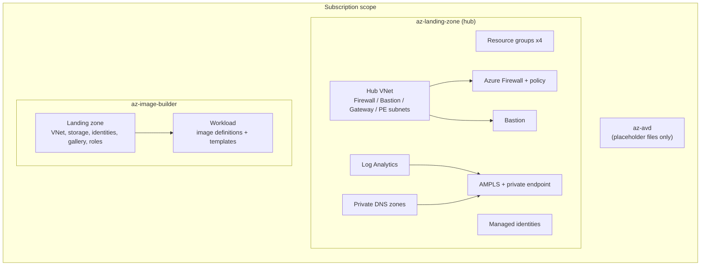
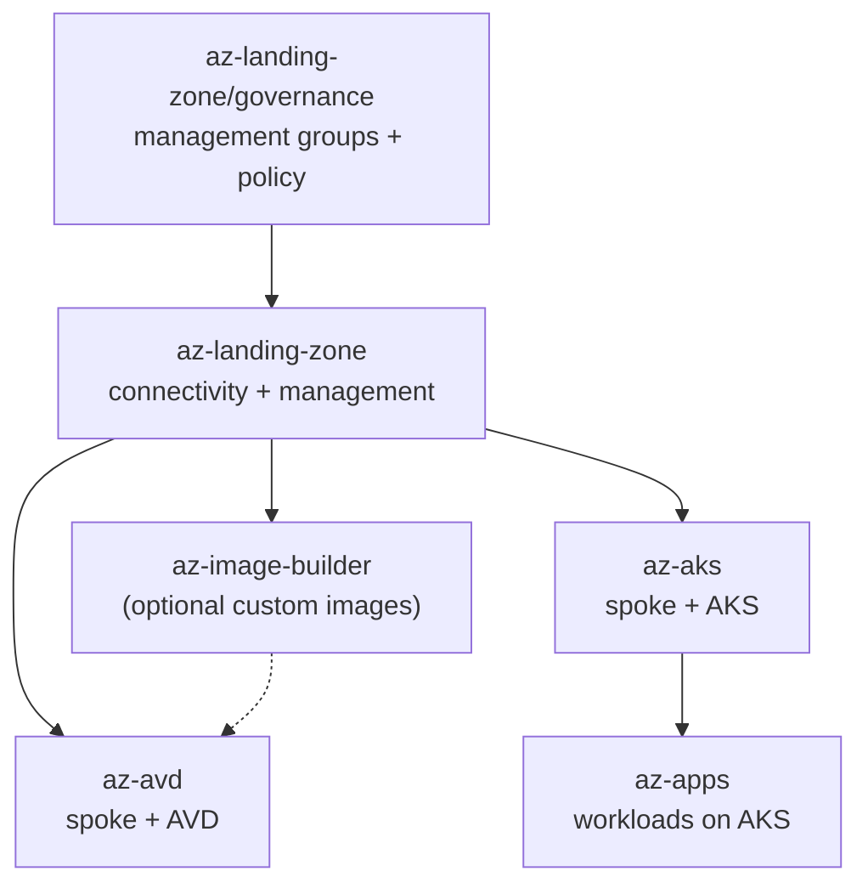
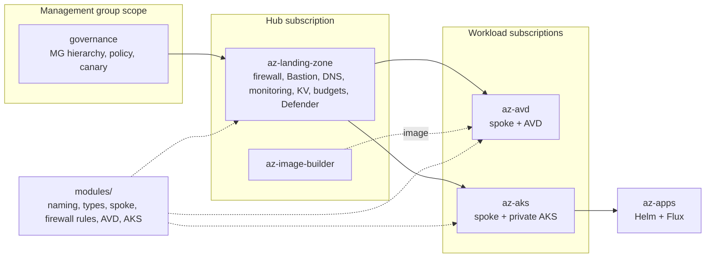

# Architecture

This document records the audit of the repository before the platform build-out (section 1), the conventions applied since (section 2), the deployment order (section 3) and how each audit gap was closed (section 4).

## 1. Current state (audit)

### az-landing-zone

| Area | State |
|---|---|
| Scope | Subscription. One `main.bicep`, one `params/hub.bicepparam` (prod only). |
| Resources | 4 resource groups, 2 user-assigned identities, hub VNet (firewall, bastion, gateway, optional private endpoint subnet), firewall policy with JSON rule collections, Azure Firewall, Bastion, private DNS zones linked to the hub, Log Analytics, AMPLS with private endpoint when public access is disabled. |
| Modules | Thin local wrappers around AVM, each translating `enableLock`/`lockKind` into the AVM `lock` object. |
| Parameters | Untyped `object`/`array` parameters, documented only in `@description` strings. |
| AVM pins | resource-group 0.4.3, user-assigned-identity 0.5.0, workspace 0.15.0, virtual-network 0.9.0, azure-firewall 0.10.0, firewall-policy 0.3.0, bastion-host 0.8.0, private-dns-zone 0.8.0, private-link-scope 0.7.0. All behind the latest published versions. |
| Lint | Clean with default analyzer settings. No `bicepconfig.json`. |

Gaps:
- No management group hierarchy or Azure Policy.
- No diagnostic settings on the firewall, Bastion, VNet or Key Vault, so platform logs never reach the workspace.
- No spoke pattern, route tables or peering. Workloads have nothing to attach to.
- The README lists Key Vault and Sentinel, but neither is deployed.
- No data collection rules or endpoints. Azure Monitor Agent has nowhere to send data.
- No budgets, no Defender for Cloud configuration, no optional gateway or DDoS plan.
- Only a prod parameter file. The `environment` value only switches the firewall tier.
- The firewall policy doesn't enable DNS proxy, so spokes can't resolve the hub's private DNS zones through the firewall.

### az-avd

Every file (main.bicep, modules, parameter files, policy assignment, script) is empty. The folder needs a full build.

### az-image-builder

Recently reworked and in good shape:
- Landing zone (VNet, ACI subnet, storage with private endpoint, gallery, least-privilege custom roles) and workload (one template per image, step pipeline, STIG hardening for Windows, Ubuntu and RHEL).
- Typed parameters (`types.bicep`), current AVM pins, offline tests (`tests/Test-ImageBuilder.ps1`, `bicep snapshot`).
- Uses the same `<workload>-<environment>-<region>-<abbreviation>` naming as the hub.

Gaps: not part of any CI pipeline; no link to AVD (the image definition it produces isn't referenced anywhere).

### Repository-wide

- No CI, no pre-commit hooks, no dependency update tracking.
- No shared modules folder; naming and tags are rebuilt in every parameter file.
- Parameter style differs between folders (objects in the hub, typed records in the image builder).
- Tag keys are `environment`, `workload`, `managedBy` in both existing folders.

## 2. Conventions applied from here on

See [CONVENTIONS.md](CONVENTIONS.md) for the full list. In short:

- `modules/` holds shared, reusable modules. Workload folders (`az-*`) are thin compositions.
- AVM first, pinned to exact versions. Local modules follow the AVM interface (`lock`, `roleAssignments`, `diagnosticSettings`, `managedIdentities`, `privateEndpoints`, `tags`, `enableTelemetry`) and import the AVM common types.
- Every deployment has `params/staging.bicepparam` and `params/prod.bicepparam` with `using`.
- Names come from `modules/shared/naming.bicep`; types from `modules/shared/types.bicep`.
- `bicepconfig.json` at the root sets the important analyzer rules to error.

## 3. Target architecture

The target platform is described in the root [README](../README.md) and in each module's README once built. The deployment order is:

## 4. State after the build-out

| Audit gap | Resolution |
|---|---|
| No management groups or policy | `az-landing-zone/governance`: hierarchy, placement, Microsoft built-in baseline, `DoNotEnforce` canary in staging (D-010) |
| No diagnostic settings on platform resources | Every resource sends `allLogs` to the central workspace; DINE policy covers resources deployed outside this repository |
| No spoke pattern | `modules/network/spoke-network` (peering, UDR to the firewall, firewall DNS proxy, NSG baseline), used by AVD and AKS |
| Key Vault and Sentinel documented but not deployed | Platform Key Vault deployed; Sentinel onboarding behind `monitoring.enableSentinel` |
| No data collection rules or endpoint | DCE in the private link scope, baseline Windows and Linux DCRs, AVD Insights and AKS rules |
| No budgets, Defender, gateway or DDoS | Budgets with forecast alerts, Defender plans, optional VPN/ExpressRoute gateway and DDoS plan |
| Only a prod parameter file | `staging` and `prod` parameter files for every deployment |
| No firewall DNS proxy | Enabled (D-008) |
| `az-avd` empty | Full AVD workload (D-012 to D-015) |
| Image Builder not in CI | Offline tests run in `validate.yml` |
| No CI, hooks or dependency updates | GitHub Actions (validate, what-if, app pipeline), GitLab CI for apps, pre-commit, Renovate |
| Parameter styles differ | Typed parameters everywhere, shared types and naming |

Not yet covered, by design or pending: `what-if` against a real subscription (needs a sandbox and the OIDC variables), enforcing image signatures in AKS, ACR cache rules to shrink the egress allowlist, and a second region.
