# Deploying from scratch

How to go from an empty tenant to a running platform. The README's [deployment order](../README.md#deployment-order) table is the short version; this is the long one. Each stack's README has the detail for its own post-deployment steps, and this guide links to them rather than repeating them.

- [0. Before you start](#0-before-you-start)
- [1. Prepare the repository](#1-prepare-the-repository)
- [2. Validate offline](#2-validate-offline)
- [3. Deploy](#3-deploy)
- [4. Check it works](#4-check-it-works)
- [5. Tear down](#5-tear-down)

> **Just want to try it?** Use the [staging sandbox path](#staging-sandbox-path): hub plus one AKS cluster, in a single subscription, without governance. It shows most of the platform for a fraction of the setup.

## 0. Before you start

### Tools

| Tool | Used for |
|---|---|
| Azure CLI 2.6x or later, with `az bicep install` | every deployment (`az bicep version` should report 0.47 or later, which is what the tooling image pins) |
| PowerShell 7 | Image Builder tools, AVD and governance scripts |
| `kubectl` and `kubelogin` | AKS access (`az aks install-cli` installs both) |
| Docker | `make validate` (all other checks run in the tooling container) |
| Git and a hosted Git account (GitHub) | Flux pulls cluster configuration from your copy of this repository |

### Azure

- **A tenant and at least one subscription.** One subscription is enough: the hub and every workload can share it. Parameter files take full resource IDs, so you can split them across subscriptions later.
- **Permissions:**

  | Stack | Needs |
  |---|---|
  | Governance | Owner, or Management Group Contributor plus Resource Policy Contributor, at the tenant root group. A Global Administrator can [elevate access](https://learn.microsoft.com/azure/role-based-access-control/elevate-access-global-admin) to get it. |
  | Hub, AVD, AKS, GitLab, Image Builder | Owner, or Contributor plus Role Based Access Control Administrator, on the subscription. AKS also needs it on the hub DNS resource group. |
  | AVD post-deployment | Cloud Application Administrator (Entra Kerberos application edits), Conditional Access administrator |

- **Region.** Every parameter file uses `eastus`. To use another region, change `location` in every parameter file you deploy, plus the hard-coded names that include `eus` (see [step 1.3](#13-fill-the-placeholders)). Before you start, check your vCPU quota for the VM families in the parameter files: `az vm list-usage -l eastus -o table`.
- **Cost.** The hub firewall, Bastion, AKS control planes, PostgreSQL and Managed Redis all bill by the hour whether or not anything uses them. The hub sets a budget alert (`budget.amount`), but nothing deletes resources for you. Tear staging down when you finish ([step 5](#5-tear-down)).

### Sign in

```bash
az login --tenant <tenant-id>
az account set --subscription <subscription-id>
az account show --query "{tenant:tenantId, subscription:id, user:user.name}" -o table
```

### Register resource providers

Do this once per subscription. Registration takes a few minutes.

```bash
for p in Microsoft.Network Microsoft.Compute Microsoft.Storage Microsoft.KeyVault \
         Microsoft.OperationalInsights Microsoft.Insights Microsoft.Monitor Microsoft.AlertsManagement \
         Microsoft.Security Microsoft.PolicyInsights Microsoft.ManagedIdentity \
         Microsoft.ContainerService Microsoft.ContainerRegistry Microsoft.KubernetesConfiguration \
         Microsoft.Dashboard Microsoft.DataProtection \
         Microsoft.DesktopVirtualization Microsoft.Automation \
         Microsoft.VirtualMachineImages Microsoft.ContainerInstance \
         Microsoft.DBforPostgreSQL Microsoft.Cache; do
  az provider register --namespace "$p" --wait
done
```

Skip the namespaces for stacks you don't deploy: AVD (`DesktopVirtualization`, `Automation`), Image Builder (`VirtualMachineImages`, `ContainerInstance`), GitLab (`DBforPostgreSQL`, `Cache`).

## 1. Prepare the repository

### 1.1 Fork or copy the repository

Flux on each cluster pulls `az-aks/gitops/clusters/<cluster>` and `az-apps/` from a Git URL, so the cluster needs a repository it can read and that you can push to. Fork this repository, or push a copy, to your own GitHub account.

The Flux extension is deployed without Git credentials, so the repository must be **public**. To keep it private, add HTTPS credentials to the Flux configuration (`configurationProtectedSettings`, as [az-gitlab step 7](../az-gitlab/README.md#bootstrap-order) does for GitLab).

### 1.2 Create the Entra groups

Create these as security groups and note each object ID (`az ad group show -g <name> --query id -o tsv`):

| Group | Used in |
|---|---|
| AKS admins, AKS readers | `az-aks/params/{staging,prod}.bicepparam` |
| Tools cluster admins and readers | `az-aks/params/tools-prod.bicepparam` (prod GitLab only) |
| AVD users, AVD admins | `az-avd/params/*.bicepparam` |
| GitLab database admins | `az-gitlab/params/*.bicepparam` (`postgres.entraAdministrators`) |
| Platform owners (optional) | governance `eligibleRoleAssignments` (PIM) |
| Image admins (optional) | `az-image-builder/landing-zone/params/landing-zone.bicepparam` |

For AVD you also need the object ID of the Azure Virtual Desktop service principal:

```bash
az ad sp show --id 9cdead84-a844-4324-93f2-b2e6bb768d07 --query id -o tsv
```

### 1.3 Fill the placeholders

Placeholders are values in `<angle brackets>`, the all-zero subscription ID, and `contoso.example` addresses. To list them:

```bash
grep -rnE '<[a-zA-Z][^>]*>|00000000-0000-0000-0000-000000000000|contoso\.example' \
  az-*/params az-landing-zone/governance/params az-image-builder/*/params az-aks/gitops/clusters
```

Fill them per stack:

| File | Set before the first deployment | Set after an earlier deployment |
|---|---|---|
| `az-landing-zone/params/<env>.bicepparam` | `monitoring.alertEmails`, `budget.contactEmails`, `budget.amount`, and optionally `breakGlassAccountObjectIds` | |
| `az-landing-zone/governance/params/<env>.bicepparam` | `subscriptionPlacement` (subscription ID per management group) | `logAnalyticsWorkspaceResourceId`, `vmDataCollectionRuleResourceId`, `vmMonitoringIdentityResourceId` from the hub |
| `az-aks/params/<env>.bicepparam` | `hubSub`, group object IDs, `gitOps.repositoryUrl` (your fork) | |
| `az-aks/gitops/clusters/<cluster>/cluster-settings.yaml` | | tenant ID, `keyVaultUri`, `externalSecretsClientId`, `registryLoginServer` from `az-aks` |
| `az-avd/params/<env>.bicepparam` | `hubSub`, group object IDs, AVD service principal ID; `galleryImageResourceId` if you use a custom image | |
| `az-image-builder/landing-zone/params/landing-zone.bicepparam` | `<hub-subscription-id>`, image admins group | |
| `az-gitlab/params/<env>.bicepparam` | `sub` | `cluster.*` (`oidcIssuerUrl`, key vault, registry) from `az-aks` |

**Hub references are predictable.** Workload parameter files build the hub's resource IDs from the naming convention (`hub-<env>-eus-*`) and the hub firewall's first IP (`10.0.0.4` in prod, `10.100.0.4` in staging). If you keep the hub's environment, region and address space, the hub subscription ID is the only hub value you change. If you change any of them, compare the workload values with the hub outputs:

```bash
az deployment sub show -n landing-zone --query properties.outputs -o json
```

**Secrets are never in parameter files.** Two deployments read passwords from environment variables, which you set in your shell just before running them:

| Variable | Deployment |
|---|---|
| `AVD_LOCAL_ADMIN_PASSWORD` | `az-avd` (session host local administrator) |
| `GITLAB_POSTGRES_PASSWORD` | `az-gitlab` (seeded into Key Vault by `scripts/seed-secrets.sh`) |

Commit and push the filled parameter files and `cluster-settings.yaml` to your fork. Flux reads from the remote, not your working tree.

## 2. Validate offline

```bash
make tools       # once: build the pinned tooling image
make validate    # build, lint, PSRule, snapshot tests, cross-deployment checks, Checkov, manifests
```

`make validate` needs no Azure access. Its cross-deployment checks catch overlapping address ranges and broken references between stacks before Azure does.

## 3. Deploy

Every subscription deployment below uses `--confirm-with-what-if` (`-c`). It shows the what-if result and asks before it changes anything. Run all commands from the repository root unless a step says otherwise.

<p align="center">
<picture>
  <source media="(prefers-color-scheme: dark)" srcset="diagrams/arch-deploy-order.dark.svg">
  
</picture>
</p>

### Step 1: Governance (optional)

This step creates the management group hierarchy, moves subscriptions into it, and assigns baseline policy. Skip it in a sandbox, or when someone else owns your management groups. `staging` builds a separate canary hierarchy (`alz-canary-*`) in audit-only mode, so it's safe to try.

```bash
az deployment mg create --management-group-id <tenant-id> --location eastus --name governance \
  --template-file az-landing-zone/governance/main.bicep \
  --parameters az-landing-zone/governance/params/<env>.bicepparam
```

The tenant root group's ID is the tenant ID. The DeployIfNotExists monitoring policies stay off until the second pass (step 1b).

### Step 2: Hub

```bash
az deployment sub create -c --location eastus --name landing-zone \
  --template-file az-landing-zone/main.bicep \
  --parameters az-landing-zone/params/<env>.bicepparam
```

The firewall makes this the longest step, at about 20 to 40 minutes. Save the outputs, because every later step needs them:

```bash
az deployment sub show -n landing-zone --query properties.outputs -o json > hub-outputs.<env>.json
```

`hub-outputs.*.json` holds resource IDs only, no secrets. `.gitignore` excludes `*-outputs.*.json` anyway.

### Step 1b: Governance again

Fill three values in `az-landing-zone/governance/params/<env>.bicepparam`, then run step 1 again:

| Parameter | Source |
|---|---|
| `logAnalyticsWorkspaceResourceId` | hub output `monitoring.logAnalyticsWorkspaceResourceId` |
| `vmDataCollectionRuleResourceId` | hub output `vmDataCollectionRuleResourceIds.windows` |
| `vmMonitoringIdentityResourceId` | hub output `loggingIdentityResourceId` |

The DeployIfNotExists policies now have a workspace to send data to.

### Step 3: Image Builder (only for custom images)

Skip this step if AVD uses marketplace images, which is the default. Run it from `az-image-builder/`; its README has the details.

```powershell
cd az-image-builder
./tools/Deploy-ImageBuilder.ps1 -LandingZone -ParamFile landing-zone/params/landing-zone.bicepparam
./tools/Get-Installers.ps1
./tools/Publish-Installers.ps1 -StorageAccountName <storage account from the landing zone output>
./tools/Deploy-ImageBuilder.ps1 -ParamFile workload/params/win11-avd.bicepparam
az image builder run -g <rg> -n <template> --no-wait     # a build takes 1 to 3 hours
```

When the build finishes, set `galleryImageResourceId` in the AVD parameter file to the image definition.

### Step 4: AVD

```bash
export AVD_LOCAL_ADMIN_PASSWORD='<from your password manager or vault>'
az deployment sub create -c --location eastus --name avd-<env> \
  --template-file az-avd/main.bicep --parameters az-avd/params/<env>.bicepparam
unset AVD_LOCAL_ADMIN_PASSWORD
```

Use `params/cloudonly.bicepparam` for a tenant with no on-premises Active Directory. Then do the manual steps, which the platform can't automate: admin consent, the Conditional Access exclusion, `Set-CloudOnlyKerberos.ps1`, and share root permissions. They're listed in [az-avd: After the first deployment](../az-avd/README.md#after-the-first-deployment-azure-files-with-entra-kerberos). Profiles don't mount until they're done.

### Step 5: App AKS cluster

```bash
az deployment sub create -c --location eastus --name aks-<env> \
  --template-file az-aks/main.bicep --parameters az-aks/params/<env>.bicepparam
az deployment sub show -n aks-<env> --query properties.outputs -o json > aks-outputs.<env>.json
```

Then:

1. Copy `keyVaultUri`, `externalSecretsClientId`, `registryLoginServer` and your tenant ID into `az-aks/gitops/clusters/<env>/cluster-settings.yaml`, then commit and push. Flux applies them on its next sync, usually within 10 minutes.
2. Approve the Grafana managed private endpoint: Azure Monitor workspace > **Networking > Private endpoint connections**.
3. Connect to the cluster. The API server is private, so either run commands from a machine with network access (Bastion jump host, VPN, peered runner) or use `command invoke`:
   ```bash
   az aks command invoke -g <cluster-rg> -n <cluster> --command "kubectl get kustomizations -A"
   ```

### Step 6: Applications

Flux deploys whatever `az-apps/deploy/<env>` references, so the cluster needs an image in its registry. The registry has no public endpoint, so the push job runs on a runner with network access to it. Set up CI as described in [az-apps: CI](../az-apps/README.md#ci) (federated identity with `AcrPush`, repository variables, a runner in a peered network), then push a change under `az-apps/src/web-app`. The pipeline builds, scans, signs and pushes the image, and opens a promotion pull request. Merging that pull request is the deployment.

### Steps 7 and 8: Tools cluster and GitLab

- **Prod** runs GitLab on its own tools cluster. Deploy `az-aks` with `params/tools-prod.bicepparam` (as in step 5, deployment name `aks-tools-prod`), then follow the [az-gitlab bootstrap order](../az-gitlab/README.md#bootstrap-order): secrets, the Azure side, the cluster side, first sign-in, and finally moving Flux to GitLab.
- **Staging** runs GitLab on tainted node pools in the step 5 cluster (`placement: 'Shared'`). Skip the tools cluster and follow the same bootstrap order from step 3.

## 4. Check it works

| Check | How |
|---|---|
| Hub egress and DNS | From a spoke VM or pod: `nslookup <registry>.azurecr.io` returns a `10.x` address; outbound traffic shows in the firewall logs (`AZFWApplicationRule` in Log Analytics) |
| Flux reconciled | `kubectl get kustomizations,helmreleases -A`: every resource `Ready=True` |
| Secrets flow | `kubectl get externalsecrets -A`: `SecretSynced` |
| App responds | `kubectl -n web-app get pods,ingress`, then a request to the internal ingress from a peered network |
| AVD | Sign in through the [Windows App](https://windows.cloud.microsoft) as a member of the users group; the profile container appears in the `profiles` share |
| Policy | Azure Policy > Compliance for the management groups; the first evaluation can take up to 24 hours |
| Monitoring | Grafana dashboards show cluster metrics; AVD Insights shows session hosts |

Some items are still unconfirmed on a live deployment. [BLOCKERS.md](../BLOCKERS.md) lists them, for example B-012. Check those first if something behaves differently from the docs.

## 5. Tear down

Prod resource groups have `CanNotDelete` locks. Staging has none.

Delete the workloads first and the hub last, because the spokes peer to the hub and add rules to its firewall policy.

```bash
# List the environment's resource groups and check the list before deleting anything.
az group list --query "[?tags.environment=='staging'].name" -o tsv

# Delete the workload groups (aks-*, avd-*, gitlab-*, ...) and wait for them to finish,
# then delete the hub-* groups.
az group delete -n <rg> --yes
```

For prod, remove the locks first (`az lock list`, then `az lock delete --ids ...`). Some resources are soft-deleted after you delete them and keep their names reserved, so a redeploy with the same names can fail:

- **Key Vaults:** soft-deleted, and purge protection is on. You can't purge them; wait out the retention period, or change the names.
- **Log Analytics workspaces:** soft-deleted for 14 days. Use `az monitor log-analytics workspace delete --force` to delete one immediately.

To remove governance, move the subscriptions back under the root management group, then delete the policy assignments and management groups (`az account management-group delete`).

## Staging sandbox path

The shortest path to a working platform in one subscription:

1. Prerequisites from [step 0](#0-before-you-start): tools, sign-in, and the providers up to `Microsoft.DataProtection`.
2. Fork the repository, create the AKS admins and readers groups, then fill `az-landing-zone/params/staging.bicepparam` (emails, budget) and `az-aks/params/staging.bicepparam` (`hubSub`, groups, `gitOps.repositoryUrl`). Push.
3. `make validate`.
4. Deploy the hub (step 2) and the AKS cluster (step 5) with `<env>` set to `staging`.
5. Fill `az-aks/gitops/clusters/staging/cluster-settings.yaml` and push. Run `az aks command invoke ... "kubectl get kustomizations -A"` to watch Flux reconcile.
6. When you're done, tear it down ([step 5](#5-tear-down)).

Leave out governance, AVD, Image Builder and GitLab. Add them later in the order above.
